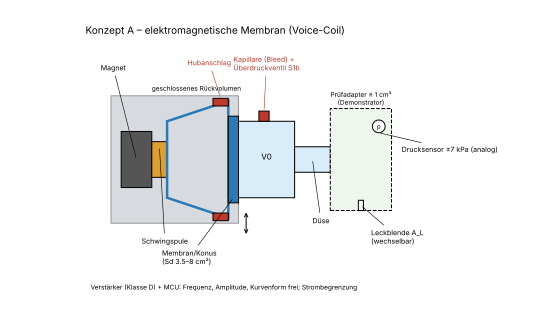
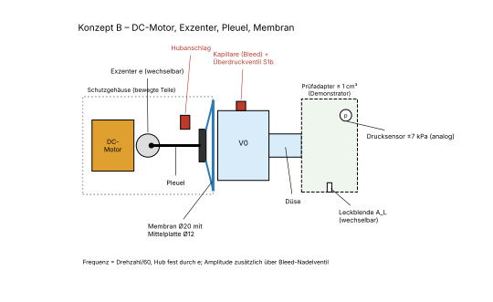
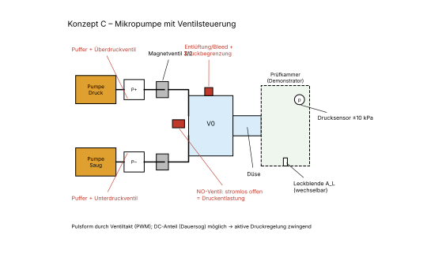

# Modular Motion Lab – Phase 1: Druckwellen-Aktuator, Konzeptvergleich

Stand 2026-11-10 · Status: **Konzeptbewertung abgeschlossen, fachlich gegengeprüft (Abschnitt 13)** · keine CAD-Konstruktion, keine Druckdateien.

**Nachweisstufen:**
- **B** = berechnet (Formel, nachvollziehbar)
- **S** = simuliert (`calculations/pressure_actuator/model.py`, Ergebnisse in `results.md`)
- **G** = geschätzt (Datenblatt-Grössenordnung, Erfahrungswert)
- **E** = experimentell belegt

**Für diese Phase liegen keine E-Werte vor.** Alle Zahlen sind am Demonstrator zu messen.

**Abgrenzung:** Diese Phase betrifft nur einen **technischen Funktionsdemonstrator**, der gegen einen Prüfadapter arbeitet. Er hat keine körperberührende Fläche und keine Anwendung am Menschen.

---

## Kurzfassung

| | A Voice-Coil | B Exzenter-Membran | C Pumpe + Ventile |
|---|---|---|---|
| Gewichtete Bewertung | **4,15** | 3,55 | (2,50 – nicht gewertet) |
| Sicherheit (K.-o.) | **bedingt erfüllt** | bedingt erfüllt | **nicht erfüllt → ausgeschieden** |
| Rolle | **Erster Prototyp = Mess- und Funktionsplattform** | Rückfalloption, später kompaktes Gerät | verworfen |

**Wichtigste Erkenntnisse:**
- Die **Abdichtung an der Düse** bestimmt die Druckamplitude stärker als der Antrieb (S).
- Bei Konzept A lässt sich der Druck **elektrisch begrenzen**: p_max = Bl·U/(Re·Sd) an einer festen 5-V-Versorgung (B).
- Bei Konzept B erfordert eine geometrische Druckbegrenzung einen sehr kleinen Exzenter (e ≤ 0,15 mm). Das kostet Druckreserve gegen Leckage (B).

## 1. Ziel

Drei Funktionskonzepte für einen kompakten, elektrisch betriebenen Aktuator vergleichen. Der Aktuator erzeugt in einer kleinen Luftkammer periodische Über- und Unterdruckwellen. Ergebnis ist eine begründete Architektur für den ersten DIY-Prototyp, der mit dem Bambu Lab H2S (FDM), dem 10-W-Laser und dem Schneidplotter gebaut werden kann.

## 2. Recherche: öffentlich dokumentierte Druckwellen-Prinzipien

| Quelle | Dokumentiertes Prinzip | Relevanz |
|---|---|---|
| Patentfamilie Novoluto/Lenke (z. B. US 9,763,851; CA 2 978 739; US 12,329,710) – Grundlage der „Pleasure Air“-Technologie | Eine Antriebseinheit ändert das Volumen einer **ersten Kammer**. Diese ist über ein Verbindungselement mit einer **zweiten, offenen Kammer** verbunden. Es entsteht ein Druckfeld aus **abwechselndem Über- und Unterdruck**, eine Hohlraumwand ist flexibel. Spätere Fassungen enthalten Sensoren und Ergonomievarianten. | Kernprinzip: **Volumenverdrängung ohne Nettoströmung**. Konkrete Kammer- und Gehäuseausführungen sind geschützt und werden **nicht** nachgebaut. |
| Patent „Device for stimulating … variable pressure field“ (US-PDF 12576003) | Wechseldruckfelder von **≈ 0,5–150 Hz**, Druckdifferenz **≈ 20 mbar (2 kPa) oder mehr**, gemessen an der Gehäuseöffnung. | Plausible **Zielgrössen** (Designangaben, keine Messungen). |
| Patent „Methods for enhancing female orgasm“ (US-PDF 10646399) | Saugbetonte Variante: Überdruck ≈ 20–100 Pa, Unterdruck ≈ −1 bis −5 kPa. | Andere Architektur mit Gleichanteil (Dauersog). Für C relevant, aus Sicherheitssicht kritisch. |
| Medizinische Luftpuls-Generatoren (HFCWO, z. B. US 7,785,280; 7,121,808; 7,770,479) | Motor mit Nocken, Scotch-Yoke oder Kurbel bewegt Membranen in einer Kammer. Frequenz = Drehzahl, typ. 5–25 Hz. „Kleineres Totvolumen → grösserer Druckpuls“. | Bewährte Mechanik für **B**, bestätigt den Totvolumen-Effekt. |
| Produktbeschreibungen (Womanizer, Handel) | „Luftfenster öffnet und schliesst“, berührungsloses Druckwellenprinzip. | Nur qualitativ. |

**Unabhängige Messungen an Konsumgeräten wurden nicht gefunden.** Die Zielwerte unten sind deshalb Projektannahmen.

**Schutzrechte:** Das Grundprinzip ist durch die Novoluto-Patentfamilie beansprucht. Eine **private, nicht gewerbliche** Nutzung für einen Demonstrator ist nach Schweizer Recht (Art. 9 Abs. 1 lit. a PatG) in der Regel zulässig. Vor jeder Veröffentlichung von Bauanleitungen, vor Verkauf oder Weitergabe ist eine Freedom-to-operate-Prüfung durch eine Fachperson nötig. **Keine Rechtsberatung.**

## 3. Gemeinsame Randbedingungen (Projektannahmen)

| Grösse | Wert | Status |
|---|---|---|
| Druckamplitude Ziel | ±2 kPa (±20 mbar) am Düsenaustritt | Annahme, angelehnt an die Patentangabe |
| Frequenzbereich | 5–150 Hz (B realistisch 10–150 Hz) | Annahme |
| **Harte Druckgrenze** | **\|p\| ≤ 5 kPa** in jedem Einzelfehlerfall | Projektgrenze für den Demonstrator, **kein validierter physiologischer Grenzwert**. Vor jeder späteren Anwendung durch Fachpersonen festzulegen |
| Gleichanteil | < 0,2 kPa nach 1 s | Funktionsanforderung (Wechseldruck, kein Dauervakuum) |
| Totvolumen V0 | 1–4 cm³ | Konstruktionsziel |
| Versorgung | extern, SELV, fest 5 V (A, B), ohne USB-PD | Pflicht |
| Prüfling | Prüfadapter ≤ 1 cm³ mit wechselbaren Leckblenden, kein Körperkontakt | Pflicht |

## 4. Physikalische Grundlagen

**Druck aus Volumenänderung (B):** Bei dichter Kammer gilt näherungsweise

  p ≈ γ · p0 · ΔV / V0  (γ = 1,4, p0 = 101,3 kPa)

| V0 | ΔV für ±2 kPa | ΔV für ±5 kPa |
|---|---|---|
| 1 cm³ | 14 mm³ | 35 mm³ |
| 2 cm³ | 28 mm³ | 70 mm³ |
| 4 cm³ | 56 mm³ | 141 mm³ |

Die nötigen Hubvolumen sind sehr klein: 28 mm³ entsprechen einer Membran Ø20 mit ≈ 0,14 mm Hub.

**Wärmeübergang:** Die thermische Grenzschicht ist bei 5 Hz ≈ 1,2 mm, bei 150 Hz ≈ 0,22 mm dick (B). In Kammern mit wenigen Millimetern Höhe ist die Verdichtung bei tiefen Frequenzen teilweise isotherm. Der reale Druck liegt dann 10–25 % unter der Rechnung (G). Für Sicherheitsnachweise ist die adiabatische Rechnung damit konservativ.

**Helmholtz-Resonanz (B):** Kammer 2 cm³ mit Düse Ø6 × 5 mm → f_H ≈ 2,0 kHz, mit Prüfadapter ≈ 2,4 kHz. Bei 5–150 Hz verhält sich die Kammer quasistatisch, ohne Resonanzüberhöhung.

**Leck dominiert (S):** Simulation Konzept B, Auslegungswert vor Sicherheitskorrektur (ΔV = 103 mm³, V0 = 2 cm³), Spitzenwerte in kPa:

| f | dicht | Leck Ø0,5 | Leck Ø1 | Leck Ø2 |
|---|---|---|---|---|
| 10 Hz | +7,8 / −6,9 | ±1,5 | ±0,1 | ±0,01 |
| 30 Hz | +7,8 / −6,9 | ±5,4 | ±0,9 | ±0,06 |
| 100 Hz | +7,8 / −6,9 | ±7,1 | ±4,8 | ±0,6 |
| 150 Hz | +7,8 / −6,9 | ±7,2 | ±6,0 | ±1,3 |

Folgerungen:
1. Bei dichter Kammer ist der Druck frequenzunabhängig und nur durch das Hubvolumen bestimmt. Im Dichtfall ist die Überdruckspitze grösser als die Unterdruckspitze (nichtlinear).
2. Mit Leck fällt die Amplitude bei tiefen Frequenzen stark ab. Schon Ø1 mm macht 10 Hz praktisch wirkungslos. **Die Gestaltung von Düse und Abdichtung ist die wichtigste Einflussgrösse.**
3. Am Leck entstehen bei 2 kPa Strahlen mit ≈ 58 m/s (B), das ist hörbares Zischen. Unterschiedliche Durchflussbeiwerte für Ein- und Ausströmung können wie ein Gleichrichter wirken und einen Gleichanteil aufbauen (Synthetic-Jet-Effekt). Dieser Effekt ist im symmetrischen Modell nicht enthalten und muss gemessen werden.
4. **Messvolumen:** Ein 5-cm³-Prüfadapter würde den Druck auf ≈ 30 % senken (S). Deshalb ist der Prüfadapter ≤ 1 cm³ gross, und das Modell rechnet immer mit dem Gesamtvolumen einschliesslich Sensorschlauch.
5. Die pneumatische Wirkleistung ist klein (≈ 0,03 W bei Leck Ø1 mm, B). Der Strombedarf entsteht durch die Wandlerverluste.

---

## 5. Konzepte

### Konzept A – Elektromagnetische Membran (Voice-Coil)

**Prinzip:** Ein Voice-Coil-Wandler bewegt eine Membran. Deren Vorderseite bildet mit der Düse die Druckkammer V0. Ein Klasse-D-Verstärker, angesteuert vom Mikrocontroller, gibt Frequenz, Amplitude und Kurvenform frei vor. Zwei Bauformen kommen in Frage:
- **A1:** Kleinlautsprecher Ø36–40 mm, 4 Ω, mit gutem Bl. Die Rückseite bildet ein geschlossenes Rückvolumen Vb ≥ 5·V0 mit Druckausgleichskapillare.
- **A2 (Variante, am Demonstrator mitzuprüfen):** Exciter bzw. Voice-Coil-Motor treibt eine **eigene, geplottete Membran Ø16–20 mm**, wie bei B. A2 hat ein höheres Druck/Strom-Verhältnis, braucht weniger als 0,5 W und hat einen höheren Eigenfertigungsanteil.

**Solenoid (Hubmagnet):** geprüft und verworfen. Er hat nur Ein/Aus-Lagen, erzeugt Anschlagklicks und Oberwellen, braucht hohe Halteströme und lässt sich in der Amplitude kaum regeln.

| Merkmal | Wert | Stufe |
|---|---|---|
| Luftfeder der Kammer (Ø40, V0 4 cm³) | k = γ·p0·Sd²/V0 ≈ 22,7 kN/m → Systemresonanz ≈ 1,1 kHz | B (Masse 0,5 g G) |
| Betriebsart | **steifigkeitsgesteuert:** Druck ∝ Strom, Frequenzgang flach bis weit über 150 Hz | B |
| Kenngrösse für die Treiberwahl | **Bl/Sd** (Druck pro Ampere), nicht der Durchmesser | B |
| Ø40, 4 Ω, Bl 1,5: 2 kPa dicht | 1,07 A / 4,3 V Spitze, ≈ 1,8 W | B aus G |
| Ø28, 8 Ω, Bl 0,6: 2 kPa dicht | 1,17 A / 9,3 V Spitze, ≈ 5,4 W → **an 5 V nicht erreichbar** | B aus G |
| A2 Exciter Bl ≈ 2, Membran 2 cm² | ≈ 0,1 A für 2 kPa, ≈ 0,15 W | B aus G |
| **Elektrische Druckgrenze** p_max = Bl·U/(Re·Sd) | Ø40 bei 5 V: 2,0–2,9 kPa; bei 12 V: 4,7–7,0 kPa | B aus G |
| Frequenzbereich | 1–200 Hz; untere Grenze durch Verstärker-Hochpass (Moduleingang) | G, prüfen |
| Abmessungen | A1 ≈ 50 × 50 × 60 mm, A2 ≈ 35 × 35 × 50 mm | G |
| Teile | ≈ 14 (davon 6–8 gefertigt) | G |

**Druckverlauf:** Beliebige Kurvenform (Sinus, gerundete Pulse, Bursts, Rampen). Amplitude und Frequenz sind unabhängig, eine geschlossene Druckregelung ist möglich. Steile Flanken können kurzzeitig bis ≈ 2× überschwingen (G). Die Flankensteilheit wird deshalb begrenzt.

**Geräusch:** Es gibt keine rotierenden Teile. Hörbar sind Oberwellen, Gehäuseresonanzen und Leckzischen. Voraussichtlich das leiseste Konzept (G).

**Fertigung:**
- FDM: Gehäuse, Kammer, Düse, Rückvolumen, Treiberklemmung (PETG; PLA nur für Passproben).
- Plotter: Dichtungen, bei A2 die Membran.
- Laser: Prüfstand-Grundplatte, Leckblenden.

**Risiken:**
- **DC-Fehler im Verstärker:** Die Spule überhitzt. Der Bleed baut den statischen Druck ab, der Drucksensor sieht den Fehler deshalb nach ≈ 1 s nicht mehr. Ein Koppelkondensator ist bei 4 Ω und 5 Hz nicht praktikabel (8–20 mF bipolar, B). Stattdessen: Fensterkomparator auf der tiefpassgefilterten Ausgangsdifferenz und Shunt-Strommessung schalten über einen Load-Switch bzw. den Abschalteingang des Verstärkers ab.
- **Leckpfade im Lautsprecher:** Polkernbohrung, Staubkappe und atmende Sicke verbinden Vorder- und Rückseite. Abdichten und den tatsächlichen Wert von ΔV vorab messen.
- **Spulenerwärmung:** Bei tiefen Frequenzen bewegt sich die Membran kaum und kühlt die Spule schlecht. Rth 20–40 K/W ergibt bei 1,8 W einen Anstieg von 36–72 K (G). Re steigt dabei um bis zu 35 %, die Kraft sinkt. NTC direkt am Magnet, Druckregelung.
- **Hubanschlag:** Für 5 kPa müsste er bei ≈ 0,18 mm liegen (B). Das liegt in der Grössenordnung der FDM-Toleranz. Er dient deshalb nur als **mechanischer Backup**, nicht als Hauptbegrenzung.

### Konzept B – Motorisierte Membran (Exzenter + Pleuel)

**Prinzip:** Ein DC-Motor ohne Getriebe treibt einen Exzenter. Ein Pleuel bewegt eine Mittelplatte in einer eingespannten Elastomermembran. Es gibt keine Ventile, die Frequenz entspricht Drehzahl/60.

| Merkmal | Wert | Stufe |
|---|---|---|
| Membran Ø20, Mittelplatte Ø12 → A_eff | 205 mm² | B |
| **Sicherer Exzenter (Doppelhub-Kriterium)** | e ≤ 0,17 mm bei V0 = 2 cm³ → **e = 0,15 mm** (p_worst 4,5 kPa) | B |
| Amplitude dicht bei e = 0,15 mm | ±2,2 kPa, mit jedem Leck weniger | B / S |
| Alternative: grössere Kammer | e = 0,34 mm braucht V0 ≥ 5 cm³ (p_worst 4,0 kPa), dann gleiche Amplitude | B |
| Lastmoment | wechselt je Umdrehung das Vorzeichen, ±0,35 mN·m (5 kPa, e 0,34) | B |
| Drehzahl / Frequenz | Bürstenmotor stabil erst ab ≈ 600–900 min⁻¹ → **≈ 10–150 Hz**; Gimbal-BLDC mit FOC ab ≈ 1 Hz | G |
| Elektrische Leistung | 0,5–1,5 W | G |
| Abmessungen | ≈ 35 × 30 × 60 mm (miniaturisiert ≈ 25 × 25 × 50 mm) | G |
| Teile | ≈ 18 (davon 8 gefertigt) | G |

**Hubvolumen:** **Nur feste, codierte Exzenter mit e ≤ 0,15 mm** (bzw. passend zum V0 nach dem Doppelhub-Kriterium). Unsichere Varianten werden gar nicht erst gefertigt. Eine verstellbare Kurbel entfällt, weil eine Fehleinstellung ein Einzelfehler wäre. Die Amplitude lässt sich im Betrieb nur über ein Bleed-Nadelventil **absenken**.

**Zielkonflikt:** Die geometrische Druckbegrenzung macht B robust. Gleichzeitig hält sie die Amplitude im Dichtfall auf ≈ 2,2 kPa, und jedes Leck senkt sie weiter. Für Leckkompensation bei tiefen Frequenzen fehlt dadurch Reserve.

**Mechanik und Antrieb:**
- 100 Hz ergeben 3,6·10⁵ Lastwechsel pro Stunde. Für Exzenter und Pleuel sind Kugellager 683/693 vorgesehen, ein Gegengewicht gegen Unwucht und eine Schwungscheibe gegen das Rasten.
- Drehzahlregelung: Encoder mit ≥ 12 Impulsen pro Umdrehung (Schlitzscheibe oder Magnetencoder), H-Brücke (z. B. DRV8833), PWM ≥ 20 kHz.
- Der N20 ohne Getriebe kann im Verdichtungstotpunkt stehen bleiben (G).

**Geräusch:** Kommutator, Lager und Unwucht. Voraussichtlich lauter als A (G). Ein Gimbal-BLDC wäre leiser, kostet aber CHF 15–25 mehr (G).

**Fertigung:**
- FDM: Gehäuse, Kammer, Exzenter, Pleuel, Klemmring.
- Plotter: Membran, Dichtungen.
- Laser: Prüfstand, Leckblenden.

Der Eigenfertigungsanteil ist am höchsten. Die Funktion hängt aber direkt von der Membranfolie ab.

### Konzept C – Mikropumpe mit Ventilsteuerung

**Prinzip:** Je eine Mikromembranpumpe (Typ 370) füllt einen Überdruck- und einen Unterdruckpuffer. Zwei 3/2-Magnetventile schalten die Kammer abwechselnd auf P+ und P−. Ein stromlos offenes Ventil entlastet die Kammer bei Abschaltung.

| Merkmal | Wert | Stufe |
|---|---|---|
| Pumpe Typ 370 | 1–2 l/min, 40–80 kPa bzw. −40 kPa | G |
| Ventilschaltzeit | 10–20 ms (mit Peak-and-Hold etwas schneller) → **≈ 5–25 Hz** | G |
| Druckanstieg 2 cm³, Ventil Ø1 mm | ≈ 1,6 ms; reale Miniventile Ø0,3–0,6 mm: 3–11× langsamer | B |
| Leistung | 2–4 W; das NO-Ventil ist im Betrieb dauernd bestromt (1–2 W Dauerwärme) | G |
| Abmessungen / Teile | ≈ 70 × 50 × 40 mm / ≈ 22 (davon 4 gefertigt) | G |

**Stärken:**
- Gleichanteil (Dauersog) möglich.
- Sehr tiefe Frequenzen und Pausen möglich.

**Schwächen:**
- Erzeugt geschaltete Druckstösse statt eines reinen Wechseldruckfelds.
- Frequenz nur bis ≈ 25 Hz.
- Laut, teuer, viele Kaufteile.
- **Die Druckquelle ist 8–16-mal stärker als die Grenze.** Der Gleichanteil ist die Kernfunktion von C und widerspricht damit der Gleichanteil-Anforderung.

---

## 6. Vergleich

| # | Kriterium | A Voice-Coil | B Exzenter-Membran | C Pumpe + Ventile |
|---|---|---|---|---|
| 1 | Funktionsprinzip | Volumenverdrängung, elektrodynamisch | Volumenverdrängung, kinematisch | Druckquellen + Schaltventile |
| 2 | Aktuator / Leistung | Voice-Coil, 0,15–2 W (treiberabhängig) | DC-Motor, 0,5–1,5 W | 2 Pumpen + 3 Ventile, 2–4 W |
| 3 | Druckverlauf | beliebig | sinusähnlich, Amplitude fest | Rechteckpulse, Gleichanteil |
| 4 | Frequenz / Regelbarkeit | 1–200 Hz, f und p unabhängig, geregelt | ≈ 10–150 Hz, p nur über Exzenter/Bleed | ≈ 5–25 Hz, Tastverhältnis |
| 5 | Mechanische Komplexität | gering | mittel (Lager, Pleuel, Unwucht, Encoder) | hoch (Pneumatiknetz) |
| 6 | Abmessungen / Teile | 35–60 mm / ≈ 14 | 25–60 mm / ≈ 18 | ≈ 70 mm / ≈ 22 |
| 7 | Energie / Geräusch | gering–mittel / leise (G) | gering / mittel (G) | mittel / laut (G) |
| 8 | Fertigbarkeit | gut (A2 sehr gut) | gut, Membranfolie kritisch | mässig, überwiegend Kaufteile |
| 9 | Kosten Demonstrator | ≈ CHF 45–60 | ≈ CHF 40–50 (BLDC 55–65) | ≈ CHF 60–85 |
| 10 | Hauptrisiko | DC-Fehler, Spulenwärme, Treiberwahl | Zielkonflikt Sicherheit/Amplitude, tiefe Drehzahl | Überdruckquelle, Frequenzgrenze |

| | Vorteile | Nachteile |
|---|---|---|
| A | Frei programmierbar, ideale **Messplattform**. Elektrisch druckbegrenzbar, leise, wenig Mechanik. | Treiberwahl nach Bl/Sd kritisch. DC-Schutz in Hardware nötig. Leckpfade im Lautsprecher. |
| B | Geometrisch druckbegrenzbar, billig, robust, bewährtes Prinzip, kompakt. | Kleine Amplitudenreserve bei sicherem Exzenter. Tiefe Frequenzen nur mit Encoder/BLDC. Geräusch. Folie entscheidend. |
| C | Gleichanteil, tiefe Frequenzen. | Sicherheitsarchitektur, ≤ 25 Hz, laut, teuer. |

## 7. Sicherheit und Prüfkonzept

Die Grenze von 5 kPa ist eine **Projektannahme für den Demonstrator und kein physiologisch validierter Wert**.

### 7.1 Mindestanforderungen (K.-o., nicht kompensierbar)

| ID | Anforderung | Nachweis |
|---|---|---|
| S1 | \|p\| ≤ 5 kPa im **ungünstigsten Einzelfehler**: Düse in Hubendlage dicht verschlossen, Bleed verstopft, maximale Ansteuerung, exakte (nichtlineare) Rechnung. A: über die Spannungsgrenze Bl·U/(Re·Sd) mit gemessenem Bl und Re. B: über das Doppelhub-Kriterium | Rechnung plus Messung mit **Blindstopfen direkt an der Düse**, Bleed verschlossen |
| S1b | Zweite, unabhängige Barriere gegen **statischen** Druck (Erwärmung +10 K → 3,5 kPa, DC-Fehler): passives Zweiwege-Überdruckventil (Lippen- oder Schirmventil), Öffnungsdruck 4 kPa ±20 % | Öffnungsdruck an jedem Exemplar messen |
| S2 | Gleichanteil < 0,2 kPa nach 1 s über eine Kapillare Ø0,2 × 30 mm (τ ≈ 0,2 s). **Funktion, keine Sicherheitsfunktion** (verstopfbar) | Sprungantwort |
| S3 | Mechanische Hubbegrenzung als Backup. A: Anschlagring; B: Exzenter ist der Anschlag. Exzenter codiert, unsichere Varianten werden nicht gefertigt | Konstruktion, Sichtprüfung |
| S4 | Externe SELV-Versorgung, **fest 5 V**, Netzteil ohne USB-PD, keine Powerbank, kein Akku in Phase 1. Sicherung nach dem Bemessungsstrom des Wandlers (nicht pauschal 1 A) | Datenblatt, Kurzschlusstest |
| S5 | Spule bzw. Motor ≤ 60 °C an der Oberfläche. NTC thermisch direkt an Spule bzw. Motor, Abschaltung, Überstromabschaltung über Shunt. **PLA für Funktionsteile ausgeschlossen** (Glasübergang ≈ 60 °C) | Dauerlauf 30 min, Thermoelement |
| S6 | Fehlerfall = drucklos: Stromausfall, Watchdog-Reset oder Abschaltung führen zu Antrieb aus und Druckabbau über S1b und S2 | Fehlerinjektion |
| S7 | Bewegte Teile vollständig eingehaust, auch für den Bruchfall (Membranriss, gelöste Madenschraube oder Exzenter bei 9000 min⁻¹). Inspektionsintervall der Membran festlegen | Sichtprüfung, Prüfstift |
| S8 | Reale Druckschwingung gemessen, bevor andere Eigenschaften bewertet werden | Messprotokoll |
| S9 | Drucksensor: Überlastfestigkeit ≥ 16 kPa (Worst Case). Sättigung, Ausfall oder Timeout führt zur Abschaltung. Nullpunkt bei jedem Start prüfen, Plausibilisierung gegen U-Rohr bzw. Spritze und gegen den Strom. Abtastrate nachgewiesen. Schlauchvolumen zu V0 gerechnet | Datenblatt, Prüfprotokoll |
| S10 | Automatischer Abbruch bei \|p\| > 4 kPa mit nachgewiesener Reaktionszeit < 50 ms. Ein Sensorfehler darf die Druckregelung nicht in die Sättigung treiben (Stellgrösse begrenzt) | Fehlerinjektion |
| S11 | Firmware: Amplituden-, Flanken- und DC-Grenze zusätzlich in Hardware, Watchdog, sicherer Startzustand (Ausgang aus) | Code-Review, Test |
| S12 | Gehörschutz: In der Kammer liegen 2 kPa bei ≈ 160 dB SPL. **Düse nie ans Ohr.** Betrieb nur mit montiertem Prüfadapter, Warnhinweis am Gerät | Kennzeichnung |
| S13 | Brand: nur beaufsichtigter Betrieb auf nicht brennbarer Unterlage. Gehäuse PETG (bei Bedarf V0-Material), NTC-Abschaltung | Dauerlauf |

**Urteil je Konzept (K.-o.-Kriterium):**

| Konzept | Urteil | Bedingungen |
|---|---|---|
| A | **bedingt erfüllt** | Feste 5-V-Schiene, Treiber mit p_max = Bl·U/(Re·Sd) ≤ 4 kPa (gemessen), DC-Detektor mit Abschaltung, Shunt und passende Sicherung, NTC, passives Ventil S1b. A2-Exciter nur mit Spannungs- oder Strombegrenzung, weil 13 kPa bei 5 V möglich wären (B). |
| B | **bedingt erfüllt** | Codierte Exzenter e ≤ 0,15 mm (V0 2 cm³) oder grösseres V0 nach Doppelhub-Kriterium, keine verstellbare Kurbel, Ventil S1b (Erwärmung), Einhausung für Bruchfall. Der Begriff „eigensicher“ wird nicht verwendet, korrekt ist „geometrisch amplitudenbegrenzt“. |
| C | **nicht erfüllt → ausgeschieden** | Die Druckquelle ist 8–16-mal stärker als die Grenze, die Absicherung hängt an einstellbaren Billigventilen, S3 ist nicht anwendbar, und der Gleichanteil widerspricht S2. |

### 7.2 Prüfaufbau und Reihenfolge

- **Prüfadapter** (FDM, PETG) ≤ 1 cm³ an der Düse. Wechselbare **Leckblenden** Ø0 (dicht), 0,5, 1, 2, 3 mm als Laserteile, gleiches Prinzip wie bei der Blendenmessstrecke M08. Dazu ein **Blindstopfen** für S1.
- **Drucksensor** analog, differenziell ±7 kPa (z. B. MPXV7007DP, Ansprechzeit ≈ 1 ms, G), am ADC des Mikrocontrollers mit ≥ 5 kHz. Überlastfestigkeit laut Datenblatt prüfen. Statische Kalibrierung gegen das U-Rohr M12. Ein I²C-Sensor erreicht 2 kHz wahrscheinlich nicht (G).
- **Messgrössen:** p_max, p_min, Gleichanteil, Kurvenform, Frequenz, Druck mit Blindstopfen, Strom, Spannung, Temperatur nach 30 min, dB(A) in 30 cm.
- **Reihenfolge A:** Treiber vermessen (Bl, Re) → mit kleinster Ansteuerung und grösster Leckblende beginnen → Ansteuerung steigern → Blindstopfen → Fehlerinjektion (DC, Sensor ziehen, Reset).
- **Reihenfolge B:** kleinster Exzenter und grösste Leckblende → kleinere Blenden → Blindstopfen. Die Ansteuerung zu senken bringt bei B nichts, der Druck hängt nur an der Geometrie.
- **Abbruch** automatisch bei \|p\| > 4 kPa (S10).

## 8. Risikoanalyse

W = Wahrscheinlichkeit, A = Auswirkung (1–3), R = W·A.

| ID | Risiko | Konzept | W | A | R | Massnahme |
|---|---|---|---|---|---|---|
| R1 | Unbekannte Folie ungeeignet (Ermüdung, Permeation, Weichmacher/PVC) | B, A2 | 3 | 2 | 6 | Identifizieren (s. u.), sonst TPU 0,1–0,2 mm oder Silikon 0,3–0,5 mm kaufen. Unbekannte Folie nie lasern |
| R2 | Überdruck im Dichtfall | C; A ohne Spannungsgrenze; B mit zu grossem e | 2 | 3 | 6 | S1, S1b, S3 |
| R3 | Leck an der Düse macht tiefe Frequenzen unwirksam | alle | 3 | 2 | 6 | Düsengeometrie, Leckblenden-Messreihe |
| R4 | FDM-Kammer undicht | alle | 2 | 2 | 4 | ≥ 4 Wände, 100 % Füllung um die Kammer, Abfallprüfung |
| R5 | DC-Fehler Verstärker → Spulenbrand | A | 2 | 3 | 6 | DC-Detektor, Load-Switch, Sicherung, NTC (S5, S13) |
| R6 | Lagerverschleiss, Geräusch, Rasten bei tiefer Drehzahl | B | 2 | 2 | 4 | Kugellager, Schwungscheibe, Encoder, ggf. BLDC |
| R7 | Ventil-Frequenzgrenze | C | 3 | 2 | 6 | Konzeptgrenze (C ausgeschieden) |
| R8 | Lautsprecher-Leckpfade, Konusermüdung | A1 | 2 | 2 | 4 | Polkern und Staubkappe abdichten, ΔV messen |
| R9 | Schutzrechte bei Weitergabe | alle | 2 | 3 | 6 | FTO-Prüfung vor Veröffentlichung |
| R10 | Rechnung weicht ab (isotherm, laminares Leck, Synthetic-Jet-Gleichanteil) | alle | 3 | 1 | 3 | Messung, Modell kalibrieren |
| R11 | Bleed verstopft | A, B | 2 | 2 | 4 | Bleed ist keine Sicherheitsfunktion, S1b ist die Barriere |
| R12 | Drucksensor falsch, gesättigt oder ausgefallen → Regelung treibt Druck hoch | A | 2 | 3 | 6 | S9, S10, Stellgrössenbegrenzung in Hardware |
| R13 | Firmwarefehler (Startzustand, Hänger) | A, B | 2 | 2 | 4 | S11, Watchdog |
| R14 | Gehörschaden durch Düse am Ohr | alle | 1 | 3 | 3 | S12 |
| R15 | Falsches Netzteil (PD 20 V, Powerbank) | A, B | 2 | 3 | 6 | S4, Stecker mit 5-V-Codierung |
| R16 | Fehlmontage eines unsicheren Exzenters | B | 2 | 3 | 6 | Nur sichere Varianten fertigen, Codierung |

**Unbekannte Folie – Vorgehen:**
1. Dicke messen.
2. Dehnung und Rückstellung prüfen.
3. **Beilstein-Test** (Kupferdraht, Flamme, im Freien) auf Chlor: grüne Flamme bedeutet PVC/PVDC, dann ausgeschlossen.
4. Ohne sichere Identifikation nur für Passproben verwenden.

## 9. Vorläufige Stücklisten (Demonstrator, Kosten G, CHF)

Die Preise sind Schätzungen. Bei Schweizer Händlern liegen Kleinteile (z. B. Lager 683ZZ: CHF 4–8 pro Stück) deutlich über Fernost-Preisen.

**A – Voice-Coil**

| Teil | Stk | CHF |
|---|---|---|
| Lautsprecher Ø36–40, 4 Ω, Bl ≥ 1 T·m (Datenblatt) **oder** Exciter/VCM für A2 | 1 | 4–10 |
| Klasse-D-Modul (untere Grenzfrequenz prüfen, Abschalteingang) | 1 | 3–5 |
| Mikrocontroller (RP2040 / ESP32-C3) | 1 | 4–6 |
| Drucksensor analog ±7 kPa differenziell (z. B. MPXV7007DP) | 1 | 10–15 |
| Strommessung (Shunt + INA219), Load-Switch, Fensterkomparator | 1 | 5–7 |
| Passives Zweiwege-Überdruckventil (Lippen-/Schirmventil) | 1 | 2–4 |
| NTC, Sicherung, Kleinteile | 1 | 2 |
| Netzteil 5 V/2 A ohne PD (SELV, zertifiziert) | 1 | 8–10 |
| Schlauch, Schrauben, PETG ≈ 40 g, Sperrholz | – | 5 |
| **Summe** | | **≈ 45–60** |

**B – Exzenter-Membran**

| Teil | Stk | CHF |
|---|---|---|
| DC-Motor 130/N20 ohne Getriebe **oder** Gimbal-BLDC 2204 + Treiber (+15–25) | 1 | 2–4 |
| Kugellager 683ZZ | 2 | 4–16 |
| H-Brücke DRV8833, Encoder (Schlitzscheibe + Gabellichtschranke) | 1 | 4–6 |
| Membranfolie TPU/Silikon (falls nötig), Stahlstift, Madenschraube | – | 5 |
| Mikrocontroller, Drucksensor, Ventil S1b, NTC, Sicherung, Netzteil (wie A) | – | 26–37 |
| PETG ≈ 50 g, Sperrholz, Schrauben | – | 3 |
| **Summe** | | **≈ 44–71** (Bürstenmotor ≈ 44–55) |

**C – Pumpe + Ventile** (nur zur Information, ausgeschieden): Pumpen 2 × 4–6, Ventile 3 × 4–7, Begrenzungsventile 2 × 3–5, Treiber, Sensor, Netzteil 12 V → **≈ CHF 60–85**.

## 10. Bewertung

Punkte 1 (schlecht) – 5 (sehr gut). Die Werte sind nach den Gutachten angepasst (Abschnitt 13).

| Kriterium | Gewicht | A | B | C |
|---|---|---|---|---|
| Eignung des Druckwellenprinzips | 25 % | 5 | 4 | 2 |
| Technische Realisierbarkeit | 20 % | 4 → **3** | 4 → **3** | 3 → **2** |
| Fertigbarkeit mit vorhandenen Maschinen | 20 % | 4 | 5 → **4** | 3 |
| Kompaktheit und Geräusch | 15 % | 4 | 3 | 2 |
| Kosten und Bauteilverfügbarkeit | 10 % | 4 | 5 → **4** | 3 |
| Einstellbarkeit und Erweiterbarkeit | 10 % | 5 | 3 | 4 |
| **Gewichtete Summe** | | **4,15** | **3,55** | 2,50 |
| Sicherheit (K.-o.) | | bedingt erfüllt | bedingt erfüllt | **nicht erfüllt → nicht gewertet** |

**Begründungen:**
- **Prinzip:** A erzeugt das Wechseldruckfeld direkt in beliebiger Form. B erzeugt es sinusähnlich mit festem, aus Sicherheitsgründen kleinem Hub. C schaltet Druckquellen.
- **Realisierbarkeit:**
  - A wird abgewertet: Treiberwahl, DC-Schutz und Lautsprecherleckpfade sind ungelöst.
  - B wird abgewertet: Regelung bei tiefer Drehzahl, kleine Amplitudenreserve.
  - C wird abgewertet: Ventilzeiten und Spulenwärme.
- **Fertigbarkeit:** B wird abgewertet wegen Lager, Gegengewicht, Membranklemmung und der unbekannten Folie. A2 würde A hier verbessern.
- **Kompaktheit/Geräusch:** A hat keine Rotation. B hat Motor, Lager und Unwucht. C hat Pumpe und Ventilklicken.
- **Kosten:** B ist mit Encoder, H-Brücke und Ventil S1b nicht mehr deutlich billiger als A.
- **Einstellbarkeit:** A ist softwaredefiniert. C bietet Tastverhältnis und Gleichanteil. B bietet nur Frequenz und Exzenter.

Die Reihenfolge A > B > C bleibt unter allen Änderungsvorschlägen der Gutachten unverändert. Ein Sensitivitätsfall: Mit Exciter-Variante A2 und Gimbal-BLDC für B steigen A auf ≈ 4,35 und B auf ≈ 4,0 (G).

## 11. Empfehlung

**Erster Prototyp: Konzept A als Mess- und Funktionsplattform.** Er wird mit A1 (Lautsprecher Ø36–40, 4 Ω) und als Vergleich A2 (Exciter mit geplotteter Membran) aufgebaut. Bedingungen:
1. Feste 5-V-SELV-Versorgung ohne USB-PD. Bl und Re des Treibers werden gemessen, und p_max = Bl·U/(Re·Sd) ≤ 4 kPa ist nachgewiesen (S1). Bei A2 ist zusätzlich eine Strom- oder Spannungsbegrenzung nötig.
2. DC-Detektor mit Abschaltung (Load-Switch), Shunt-Strommessung, Sicherung nach Spulennennstrom, NTC am Magnet (S5, R5).
3. Passives Zweiwege-Überdruckventil S1b und Entlüftungskapillare S2.
4. Analoger Drucksensor mit ≥ 5 kHz, Abbruch bei 4 kPa in < 50 ms (S9, S10).
5. Prüfadapter ≤ 1 cm³, Leckblendensatz, Blindstopfen.

**Begründung:**
- A hat die höchste Bewertung.
- A misst ohne Umbau die Grössen, die jedes spätere Produktkonzept bestimmen: Frequenz, Amplitude, Kurvenform und Leckeinfluss.
- Die Druckgrenze lässt sich elektrisch statt über einen nicht fertigbaren 0,18-mm-Anschlag umsetzen.

**Konzept B bleibt die Rückfalloption und wird zur Kandidatin für ein kompaktes Gerät, sobald A die nötige Amplitude und Frequenz geklärt hat.** Vorher ist B mit dem Doppelhub-Kriterium auszulegen (e ≤ 0,15 mm bei 2 cm³). Die tiefe Frequenzgrenze ist ehrlich mit ≈ 10 Hz anzugeben, sonst ist ein Gimbal-BLDC nötig.

**Konzept C ist ausgeschieden**, weil es die Sicherheitsanforderungen nicht erfüllt.

## 12. Offene Fragen für die Entscheidung

1. Zielfrequenzbereich: ist 5–150 Hz richtig, oder reicht 10–120 Hz? (Davon hängt ab, ob B mit Bürstenmotor genügt.)
2. Druckgrenze 5 kPa als Projektgrenze akzeptiert?
3. Vorhandene Folie: Hersteller, Bezeichnung, Dicke? Gibt es ein Datenblatt?
4. Darf der erste Prototyp einen gekauften Lautsprecher bzw. Exciter enthalten? (Ja → A, maximaler Eigenanteil → B bzw. A2.)
5. Budgetrahmen für Messtechnik (analoger Sensor ≈ CHF 10–15)?

## 13. Fachliche Gegenprüfung

Drei unabhängige Gutachten (Subagents in den Rollen Pneumatics & Acoustics, Mechatronics und Safety & Test) haben Dokument und Modell geprüft. Alle drei stimmen der Empfehlung **mit Bedingungen** zu, und alle drei bestätigen, dass C verworfen wird.

| Befund | Gutachten | Umsetzung |
|---|---|---|
| „B eigensicher bei e ≤ 0,34 mm“ falsch: Doppelhub im Dichtfall ergibt 10,4 kPa | Safety, Pneumatik | Doppelhub-Kriterium im Modell, e ≤ 0,15 mm, Begriff „eigensicher“ ersetzt (Abschnitt 5 B, S1) |
| Bleed Ø0,3–0,5 mm 30× zu schnell, vernichtet die Amplitude < 30 Hz und ist keine Sicherheitsfunktion | Pneumatik, Safety | Kapillare Ø0,2 × 30 mm (τ 0,19 s) im Modell; S2 als Funktion, neue Barriere S1b |
| Statischer Druck durch Erwärmung (+10 K → 3,5 kPa) | Safety | S1b passives Zweiwege-Ventil |
| Koppelkondensator als DC-Schutz unpraktikabel (8–20 mF), Polyfuse 1 A schützt nicht | Mechatronik, Pneumatik, Safety | DC-Detektor mit Load-Switch, Shunt, Sicherung nach Spule |
| Ø28-Treiber erreicht 2 kPa an 5 V nicht; Kenngrösse ist Bl/Sd | Mechatronik | Treiberwahl nach Bl/Sd, Ø36–40/4 Ω, Leistungsangaben korrigiert |
| A ist steifigkeitsgesteuert (Resonanz ≈ 1,1 kHz); p_max = Bl·U/(Re·Sd) als elektrische Grenze statt 0,18-mm-Anschlag | Pneumatik, Mechatronik | Neue Hauptbegrenzung für A an fester 5-V-Schiene, Anschlag nur Backup |
| Prüfkammer 5 cm³ verfälscht Druck und S1-Nachweis | Pneumatik, Safety | Prüfadapter ≤ 1 cm³, S1 mit Blindstopfen an der Düse |
| I²C-Sensor schafft 2 kHz nicht sicher; Sensorüberlast und Plausibilisierung fehlen | Mechatronik, Safety | Analoger Sensor, ≥ 5 kHz ADC, S9 |
| Fehlende Anforderungen: automatischer Abbruch, Firmware, Gehör (≈ 160 dB SPL), Brand, Netzteil mit PD, Bruch bei 9000 min⁻¹ | Safety | S10–S13, S4, S7 ergänzt; Risiken R11–R16 |
| B bei 300 min⁻¹ nicht regelbar (Rasten, Lastwechsel) | Mechatronik | Frequenzbereich B ≈ 10–150 Hz, Encoder, Schwungscheibe, H-Brücke, Option BLDC |
| C erfüllt den K.-o. nicht und darf nicht gewertet werden | Safety | C als „nicht gewertet“ geführt |
| Wärmeübergang (teils isotherm), Rückvolumen Vb ≥ 5·V0, Leckzischen und Synthetic-Jet-Gleichanteil, laminare Leckanteile | Pneumatik | In Abschnitt 4 und A aufgenommen, Messung vorgesehen |
| Punktzahlen: Realisierbarkeit A, B, C je −1; Fertigbarkeit B −1 | Mechatronik, Pneumatik | Übernommen, zusätzlich Kosten B −1 (Encoder, Ventil) |
| Bessere Varianten: Exciter mit Kleinmembran (A2), Gimbal-BLDC (B); LRA ungeeignet | Mechatronik | A2 als Vergleichsvariante im Prototyp, BLDC als Option für B |

**Offen gebliebene Abweichung:** Die Gutachten Pneumatik und Safety nennen unterschiedliche Grenzen für den Exzenter von B: 0,33 mm (Verschluss in Hubmitte) bzw. 0,17 mm (Verschluss in Endlage). Massgebend ist der ungünstigere Fall, also 0,17 mm bzw. 0,15 mm mit Toleranz.

## Quellen

- [Womanizer (pressure wave vibrator) – Wikipedia](https://en.wikipedia.org/wiki/Womanizer_(pressure_wave_vibrator))
- [US 9,763,851 Stimulation device](https://uspto.report/patent/grant/9763851) · [US 2016/0213557 A1](https://insight.rpxcorp.com/pat/US20160213557A1) · [CA 2 978 739](https://brevets-patents.ic.gc.ca/opic-cipo/cpd/eng/patent/2978739/summary.html) · [US 12,329,710 B2](https://patentsgazette.uspto.gov/week24/OG/html/1535-3/US12329710-20250617.html)
- [Device for stimulating a human erogenous zone using a variable pressure field (USPTO PDF)](https://image-ppubs.uspto.gov/dirsearch-public/print/downloadPdf/12576003)
- [Methods for enhancing female orgasm (USPTO PDF)](https://image-ppubs.uspto.gov/dirsearch-public/print/downloadPdf/10646399)
- [US 7,785,280](https://image-ppubs.uspto.gov/dirsearch-public/print/downloadPdf/7785280) · [US 7,121,808](https://image-ppubs.uspto.gov/dirsearch-public/print/downloadPdf/7121808) · [US 7,770,479](https://image-ppubs.uspto.gov/dirsearch-public/print/downloadPdf/7770479)
- [Sifted – Womanizer inventor](https://sifted.eu/articles/womanizer-inventor)
