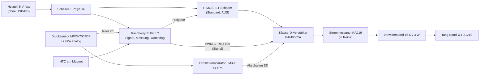

# Prototyp A – Schritt 2: Elektronik und Einkaufsliste

Stand 2026-11-12. Antrieb: Tang Band W1-2121S mit Vorwiderstand 15 Ω (Schritt 1b). Preise sind Schätzungen (G) in CHF. Die Bezugsquellen sind Beispiele (Schweiz: Bastelgarage, Distrelec, Mouser CH, Digitec/Galaxus; EU: Reichelt, Soundimports). Artikelnummern und Lieferbarkeit bitte selbst prüfen.

## 1. Aufbau

**Sicherheitsfunktionen in Hardware** (IDs aus `docs/pressure_actuator_concepts.md`, Abschnitt 7):

| Funktion | Umsetzung | Anforderung |
|---|---|---|
| Druckbegrenzung, auch bei Elektronikfehler | **Vorwiderstand 15 Ω** an fester 5-V-Versorgung: Druck im Dichtfall ≤ 3,7 kPa (B aus G) | S1 |
| Gleichstromfehler im Verstärker | Fehlerstrom nur 0,27 A, Spule 0,26 W (B) → thermisch unkritisch. Der Druck ist durch den Vorwiderstand begrenzt. Erkennung über INA219 (Gleichanteil des Stroms) → Firmware schaltet ab | S1, S5 |
| Unabhängiger Überdruck-Abbruch | **LM393-Fensterkomparator** direkt am Sensorausgang, Schwellen ±4 kPa (1,357 V / 3,643 V am Sensor, B). Zieht den Abschalteingang des Verstärkers ohne Mikrocontroller auf LOW | S10, S11 |
| Sicherer Startzustand | Verstärker hängt an einem **P-MOSFET-Schalter**, der nur bei aktiver Freigabe durch den Mikrocontroller leitet. Mikrocontroller aus, im Reset oder abgestürzt → Verstärker stromlos | S6, S11 |
| Feste Versorgung | Netzteil mit fester Ausgangsspannung 5 V, **kein USB-PD**, keine Powerbank | S4 |
| Überstrom | Polyfuse 0,75 A (Halte-) im 5-V-Eingang | S4 |
| Temperatur | NTC 10 kΩ am Magnet des Lautsprechers, Abschaltung > 60 °C in Firmware | S5 |
| Watchdog | Hardware-Watchdog des Pico | S11 |
| Not-Aus | Kippschalter in der 5-V-Zuleitung | S6 |

## 2. Einkaufsliste

### Pflicht

| # | Teil | Spezifikation | Stk | CHF (G) | Zweck / Hinweis |
|---|---|---|---|---|---|
| E1 | **Netzteil 5 V** | Steckernetzteil 5 V DC, 2–3 A, **fester Ausgang, ohne USB-PD**, CE, Hohlstecker 5,5/2,1 (z. B. Mean Well GST18E05-P1J o. ä.) | 1 | 12–20 | S4 |
| E2 | Hohlstecker-Einbaubuchse 5,5/2,1 | passend zu E1 | 1 | 1–2 | |
| E3 | **Mikrocontroller** | Raspberry Pi Pico 2 (RP2350) oder Pico (RP2040), mit Stiftleisten | 1 | 5–8 | ADC 12 bit, PWM, Watchdog, USB-Logging |
| E4 | **Klasse-D-Verstärker** | PAM8302A-Modul (mono, 2,5 W, 5 V, **mit Abschalteingang SD**), z. B. Adafruit 2130 | 2 | 4–7 je | 1 Ersatz. Untere Grenzfrequenz prüfen (Abschnitt 3) |
| E5 | **Drucksensor** | **NXP MPXV7007DP**: Differenzdruck ±7 kPa, analog 0,5–4,5 V, 5 V, Ansprechzeit ≈ 1 ms, zwei Schlauchanschlüsse | 1 | 15–25 | S8, S9. Überlastdruck im Datenblatt prüfen (soll ≥ 16 kPa) |
| E6 | **Strommessung** | INA219-Modul (I²C, Shunt 0,1 Ω, ±3,2 A) | 1 | 4–7 | Gleichstrom-Erkennung, Plausibilisierung (S9) |
| E7 | **Komparator** | LM393 (DIP-8) | 2 | 1 | Hardware-Abbruch ±4 kPa (S10) |
| E8 | Trimmpotentiometer | 10 kΩ, Spindeltrimmer | 2 | 2 | Schwellen ±4 kPa einstellen |
| E9 | **P-MOSFET** | AO3401 oder IRLML6402 (Logikpegel, SOT-23) bzw. als THT: IRF9540N mit Treiber | 2 | 1 | Verstärker-Freigabe (S6) |
| E10 | NPN-Transistor | BC547 o. ä. | 5 | 1 | Gate-Treiber für E9 |
| E11 | **Polyfuse** | 0,75 A Halte-, ≈ 1,5 A Auslösestrom | 2 | 1 | S4 |
| E12 | **NTC** | 10 kΩ, B = 3950, mit Anschlussdrähten | 2 | 1 | Magnettemperatur (S5) |
| E13 | Kippschalter | 2-polig, ≥ 2 A | 1 | 2 | Not-Aus |
| E14 | Widerstandssortiment | 1/4 W, E12 | 1 | 5 | Teiler (10 k/20 k), Pull-ups/-downs |
| E15 | Kondensatoren | Elko 100 µF/16 V ×4, Keramik 100 nF ×10, Folie 1 µF und 10 µF ×4 | – | 4 | Abblockung, RC-Filter, ggf. Eingangskondensatoren Verstärker tauschen |
| E16 | Lochrasterplatine | 100 × 160 mm, Streifenraster oder Punkt | 1 | 4 | |
| E17 | Anschlussklemmen | Schraubklemmen 2-polig RM 5,08 | 6 | 3 | Lautsprecher, Versorgung |
| E18 | Silikonschlauch | ID 3 mm, AD 5 mm, 1 m (passend zu den Sensorstutzen) | 1 | 3 | Sensoranschluss; Volumen zu V0 rechnen |
| E19 | USB-Kabel | passend zum Pico (Micro-USB bzw. USB-C) | 1 | 3 | Programmieren, Messdaten |
| — | **Vorwiderstand 15 Ω, ≥ 3 W** | aus Schritt 1b | – | – | S1 |

**Summe Pflicht: ≈ CHF 75–110**

### Empfohlen

| # | Teil | Spezifikation | Stk | CHF (G) | Zweck |
|---|---|---|---|---|---|
| O1 | OLED-Anzeige | 0,96", SSD1306, I²C | 1 | 4–6 | Druck, Frequenz, Status ohne PC |
| O2 | Drehgeber | KY-040 o. ä. mit Taster | 1 | 2–3 | Frequenz und Amplitude einstellen |
| O3 | Steckbrett + Kabel | 830 Kontakte, Jumper-Set | 1 | 6–8 | Vorversuche vor dem Löten |
| O4 | Zweiter Drucksensor | MPXV7007DP | 1 | 15–25 | Vergleichsmessung, Ersatz |

### Nicht in dieser Liste (folgt in Schritt 3, Mechanik und Pneumatik)

- Passives Zweiwege-Überdruckventil (S1b, Lippen- oder Schirmventil)
- Entlüftungskapillare Ø0,2 mm (z. B. Dosiernadel)
- Membranfolie, Schrauben, Kleber für den Stössel

## 3. Nach Eintreffen prüfen

1. **Netzteil:** Leerlaufspannung messen (4,9–5,3 V).
2. **Drucksensor:** Datenblatt kontrollieren:
   - Überlastdruck ≥ 16 kPa (sonst anderen Sensor wählen, S9)
   - Nullpunkt bei offenen Anschlüssen ≈ 2,5 V
3. **Verstärker, untere Grenzfrequenz:**
   - Testsignal 5 Hz und 50 Hz in den Verstärker geben, Ausgangsspannung am Lautsprecher (mit 15 Ω) vergleichen.
   - Ist die Spannung bei 5 Hz deutlich kleiner (< 70 %), die Eingangskondensatoren auf der Platine durch 10 µF ersetzen bzw. umgehen.
   - Der Ausgang ist **brückengeschaltet (BTL)**: Nie einen Ausgang gegen GND messen oder verbinden.
4. **Abschalteingang SD:** Messen, ob die Platine SD intern auf HIGH zieht. Davon hängt ab, wie stark der Komparator ziehen muss. Der LM393 hat einen Open-Collector-Ausgang und zieht sicher auf LOW.
5. **Komparatorschwellen** mit einer Spritze am Sensor einstellen: Abschaltung bei +4 kPa und −4 kPa (Kontrolle: U-Rohr, 408 mm Wassersäule).

## 4. Berechnungsgrundlagen (B)

| Grösse | Wert |
|---|---|
| Gleichstrom-Fehler: Strom / Spulenleistung / Widerstandsleistung | 0,27 A / 0,26 W / 1,1 W |
| Sensor-Empfindlichkeit MPXV7007DP | 286 mV/kPa (0,5–4,5 V für ±7 kPa) |
| Schwellen ±4 kPa am Sensor | 1,357 V / 3,643 V |
| ADC-Bereich nach Teiler 2/3 | 0,33–3,00 V (≤ 3,3 V Pico) |
| Abtastrate Druck | 10 kHz geplant (Pico-ADC bis 500 kS/s) |
| Stromaufnahme gesamt | < 0,5 A (Pico 30 mA, Sensor 10 mA, Verstärker ≤ 0,3 A) |
