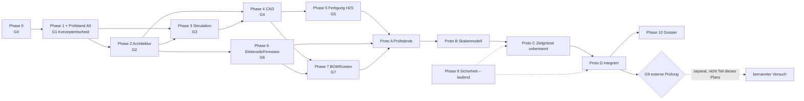

# Entwicklungsprogramm – HOVERBOARD MINI

Stand Phase 0, v0.1. **Dauerangaben sind Planwerte** unter der Annahme ≈ 10 h/Woche Arbeitszeit und einer Person mit Werkstattzugang (OQ-14). Sie sind keine Zusagen.

## 1. Abweichungsvorschlag zur Reihenfolge des Auftrags

Der Auftrag sieht Komponentenprüfstände (Prototyp A) erst in Phase 8 vor. Die Phase-0-Rechnung zeigt aber, dass der **Konzeptentscheid von drei unbekannten Grössen abhängt** (Leckspalt, Gebläsekennlinie, Schürzenschleppen). Vorschlag (D-004): einen einfachen, unbemannten Kissenprüfstand **A0** bereits in Phase 1 bauen. Prototyp A in Phase 8 bleibt bestehen und vertieft die Messungen. Freigabe durch Auftraggeber nötig.

## 2. Phasen, Gates, Dauer

| Phase | Inhalt | Hauptdisziplinen | Plandauer | Gate | Hängt ab von |
|---|---|---|---|---|---|
| 0 | Initialisierung, Anforderungen, Risiken, Abschätzung | A, B, G | erledigt (Entwurf) | G0 | – |
| 1 | Machbarkeit: Modelle, Konzeptvergleich, **Prüfstand A0** | B, I, C, H | 4–6 Wo. | G1 | G0 |
| 2 | Systemarchitektur, Budgets, Schnittstellen | A, alle | 3 Wo. | G2 | G1 |
| 3 | Simulation, Parameterstudien, Kalibrierung an A0 | B, E, C | 4 Wo. | G3 | G1, (G2) |
| 4 | Parametrisches CAD (CadQuery), Baugruppe | F, C | 4–6 Wo. | G4 | G2, G3 |
| 5 | Fertigungsplanung H2S, Materialtests | F, G | 3 Wo. | G5 | G4 |
| 6 | Elektronik, Firmware, Sicherheitslogik | D, E | 6–8 Wo. (parallel zu 4/5) | G6 | G2 |
| 7 | BOM, Lieferanten, 3 Kostenvarianten | H | 2 Wo. (laufend ab 1) | G7 | G2, G4, G6 |
| 8 | Prototypen A → B → C → D | I, alle | 12–20 Wo. | G8-A…D | G5, G6, G7 |
| 9 | Sicherheitsengineering (FMEA, FTA, Recht) – **läuft ab Phase 1 mit** | G | laufend | G9 | alle |
| 10 | Technisches Dossier | A | 3 Wo. | Abschluss | G8-D, G9 |

Grobe Gesamtdauer bis Prototyp D: **≈ 9–14 Monate** (Planwert).

## 3. Abhängigkeitsgraph

## 4. Meilensteine

| ID | Meilenstein | Nachweis |
|---|---|---|
| M0 | Anforderungen & Plan freigegeben | G0-Freigabe |
| M1 | Erster gemessener Kissendruck/Leistung am Prüfstand A0 | Messprotokoll |
| M2 | Konzeptentscheid | G1, Decision Log |
| M3 | Massen-/Leistungsbudget geschlossen | G2 |
| M4 | CAD-Baugruppe vollständig, Exporte | G4 |
| M5 | Skalenmodell schwebt und lenkt | G8-B |
| M6 | Zielgrösse schwebt unbemannt mit Ballast | G8-C |
| M7 | Integrierter Demonstrator, alle Fehlerfälle getestet | G8-D |
| M8 | Dossier und Antrag externe Sicherheitsprüfung | G9 vorbereitet |

## 5. Arbeitspakete Phase 1 (nach Freigabe)

| AP | Inhalt | Ergebnis |
|---|---|---|
| 1.1 | Randstrahl- und Schürzenmodelle aus Fachliteratur ergänzen | `hoverlib/physics.py` + Tests |
| 1.2 | Prüfstand A0 bauen (siehe `testing/test_plan_A0.md`) | Aufbau, Fotos |
| 1.3 | Messkampagne A0: Druck, Leistung, Volumenstrom, Spalt, Schleppkraft, Kippen | Rohdaten CSV + Auswertung |
| 1.4 | Modell an Messung kalibrieren (Cd·h, η_Fan) | Abweichungsbericht |
| 1.5 | Entscheidungsmatrix mit Messdaten, Sensitivität | G1-Vorlage |
| 1.6 | Gebläse-/Akku-Marktrecherche mit Datenblättern | `component_research.md` |
| 1.7 | Erste rechtliche Einordnung (Liste Fachstellen) | `safety/` |
