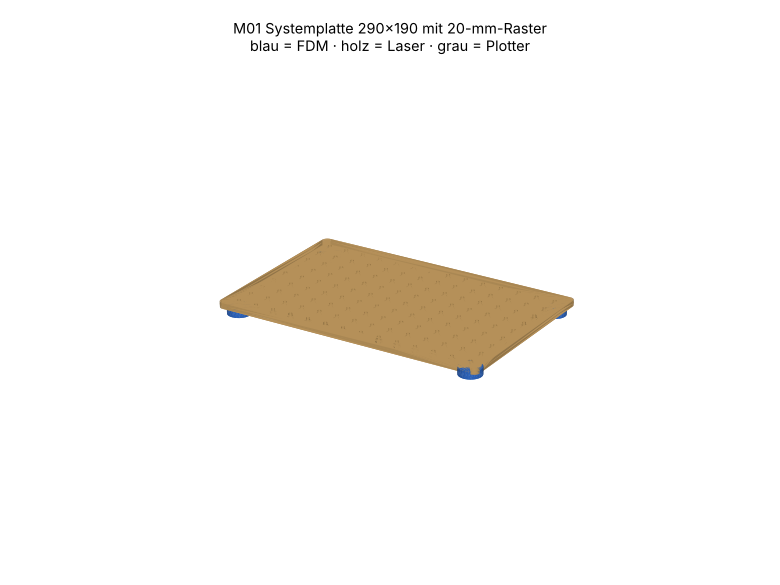

# M01 – Systemplatte 290×190 mit 20-mm-Raster

> Automatisch erzeugt von `cad/build_all.py` – nicht von Hand bearbeiten. Quelle: `cad/models/m01_systemplatte.py`

**Zweck:** Gemeinsame Basis aller Module: Prüfaufbauten schnell, reproduzierbar und ausgerichtet montieren. Enthält die Standardelemente Lagerflansch 608 und Winkelfuss, die andere Module verwenden.

3D-Ansicht: `cad/assemblies/m01_baugruppe.glb` (z. B. im Browser-glTF-Viewer). Farben: blau = FDM, holz = Laser, grau = Plotter.

**Status:** Konstruktion rechnerisch geprüft (Stufe B, 20/20 Prüfungen bestanden). **Fertigungsfreigabe offen** bis Kalibriercoupons M00 auf dem eigenen Gerät bestanden sind (siehe `manufacturing/process_limits.md`).

## Teile und Verfahrenswahl

| Teil | Bezeichnung | Verfahren | Material | Stk | Orientierung / Hinweis | Begründung |
|---|---|---|---|---|---|---|
| M01-P01 | Lochlage | Laser 10 W | Laser-Sperrholz Pappel/Linde 3 mm (E1, laserfähiger Leim) (FREI) | 1 | flach, Gravurseite oben | Grosse ebene Platte mit 126 präzisen Bohrungen: Laser in einem Durchgang, Druck wäre teuer/langsam und verzugsgefährdet. |
| M01-P02 | Mutterlage | Laser 10 W | Laser-Sperrholz Pappel/Linde 3 mm (E1, laserfähiger Leim) (FREI) | 1 | flach | Sechskant-Mutterfallen exakt im Raster; mit P01 verleimt → 6 mm Sandwich, verdrehsicher, Muttern nach Bedarf. |
| M01-P03 | Fuss | FDM-Druck | TPU 95A (FREI) | 4 | Auflagefläche auf Bett, Kopfsenkung oben | Rutschfest und dämpfend; TPU nur im Druck verfügbar. |

Standardelemente (Stückzahl 0 hier, werden in anderen Modulen gezählt): M01-P04 Lagerflansch 608 (Standard), M01-P05 Winkelfuss (Standard)

## Normteile

| Teil | Stk | ca. CHF/Stk |
|---|---|---|
| Mutter M3 DIN 934 (nach Bedarf, Richtwert) | 40 | 0.03 |
| Zylinderschraube M3×10 (Füsse, von unten in Mutterfalle) | 4 | 0.08 |
| Weissleim D3 (Lagen verleimen) | 1 | 0.30 |

## Kosten (Richtwert, ANN)

FDM ≈ 11 g → CHF 0.32 · Sperrholz CHF 2.15 · Normteile CHF 1.82 · Plotter/Kleinmaterial CHF 0.50 · **Summe ≈ CHF 4.79**

## Montage

1. P01 und P02 Rasterlöcher mit 2 M3-Schrauben an gegenüberliegenden Ecken ausrichten, dann flächig dünn verleimen (Schraubzwingen, Zulagen), 2 h trocknen.
2. Ausrichtschrauben entfernen. Muttern von unten in die Sechskantfallen drücken, wo Module montiert werden.
3. In die vier Eckfallen (A0, I0, A13, I13) Muttern einlegen, Füsse (P03) mit M3×10 von unten verschrauben.

## Funktionsprüfung (Stufe E – noch nicht durchgeführt)

Platte auf ebener Fläche: Kippeln < 0.5 mm; M3 in 5 beliebige Fallen eindrehen, Mutter dreht nicht mit.

## Rechnerische Prüfungen

| Prüfung | Ergebnis | Detail |
|---|---|---|
| M01-P01 Arbeitsfläche | ✅ | 290.1×190.2 mm in 300×250 |
| M01-P01 Mindeststeg 2.0 mm | ✅ |  |
| M01-P01 Gravur innerhalb Teil | ✅ |  |
| M01-P01 Material PLY3 | ✅ | FREI |
| M01-P02 Arbeitsfläche | ✅ | 290.1×190.2 mm in 300×250 |
| M01-P02 Mindeststeg 2.0 mm | ✅ |  |
| M01-P02 Material PLY3 | ✅ | FREI |
| M01-P03 Bauraum | ✅ | 24.0×24.0×8.0 mm |
| M01-P03 liegt auf Bett | ✅ | zmin=0.000 |
| M01-P03 Solid gültig | ✅ |  |
| M01-P03 Material TPU95A | ✅ | FREI |
| M01-P04 Bauraum | ✅ | 42.0×42.0×8.0 mm |
| M01-P04 liegt auf Bett | ✅ | zmin=0.000 |
| M01-P04 Solid gültig | ✅ |  |
| M01-P04 Material PETG | ✅ | FREI |
| M01-P05 Bauraum | ✅ | 20.0×18.0×12.0 mm |
| M01-P05 liegt auf Bett | ✅ | zmin=0.000 |
| M01-P05 Solid gültig | ✅ |  |
| M01-P05 Material PETG | ✅ | FREI |
| Baugruppe kollisionsfrei | ✅ |  |

## Dateien

- `manufacturing/laser_cut/m01/M01-P01_lochlage.dxf`
- `manufacturing/laser_cut/m01/M01-P01_lochlage.svg`
- `manufacturing/laser_cut/m01/M01-P02_mutterlage.dxf`
- `manufacturing/laser_cut/m01/M01-P02_mutterlage.svg`
- `manufacturing/3d_print/m01/M01-P03_fuss.step`
- `manufacturing/3d_print/m01/M01-P03_fuss.stl`
- `manufacturing/3d_print/m01/M01-P04_lagerflansch_608_standard.step`
- `manufacturing/3d_print/m01/M01-P04_lagerflansch_608_standard.stl`
- `manufacturing/3d_print/m01/M01-P05_winkelfuss_standard.step`
- `manufacturing/3d_print/m01/M01-P05_winkelfuss_standard.stl`
- `manufacturing/laser_cut/m01/m01_ply3_bogen1.svg`
- `manufacturing/laser_cut/m01/m01_ply3_bogen1.dxf`
- `manufacturing/laser_cut/m01/m01_ply3_bogen2.svg`
- `manufacturing/laser_cut/m01/m01_ply3_bogen2.dxf`
- `cad/assemblies/m01_baugruppe.glb`
