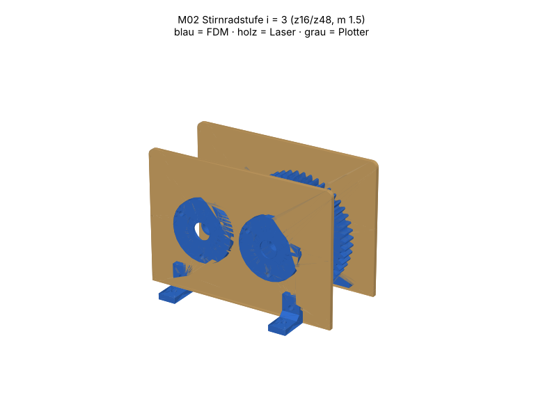

# M02 – Stirnradstufe i = 3 (z16/z48, m 1.5)

> Automatisch erzeugt von `cad/build_all.py` – nicht von Hand bearbeiten. Quelle: `cad/models/m02_stirnradstufe.py`

**Zweck:** Untersetzungsstufe für Antriebe (z. B. Verstellungen am Prüfstand, Lehrmodell Getriebe). Abtrieb: Welle Ø8 am Rad, freies Ende −y.

3D-Ansicht: `cad/assemblies/m02_baugruppe.glb` (z. B. im Browser-glTF-Viewer). Farben: blau = FDM, holz = Laser, grau = Plotter.

**Status:** Konstruktion rechnerisch geprüft (Stufe B, 42/42 Prüfungen bestanden). **Fertigungsfreigabe offen** bis Kalibriercoupons M00 auf dem eigenen Gerät bestanden sind (siehe `manufacturing/process_limits.md`).

## Teile und Verfahrenswahl

| Teil | Bezeichnung | Verfahren | Material | Stk | Orientierung / Hinweis | Begründung |
|---|---|---|---|---|---|---|
| M02-P01 | Seitenschild | Laser 10 W | Laser-Sperrholz Pappel/Linde 3 mm (E1, laserfähiger Leim) (FREI) | 2 | flach; beide Schilde im selben Job | Achsabstand und Lagerlöcher als präzise 2D-Kontur: Laser schneller, steifer und billiger als gedruckte Platte; Schilde identisch → Wellen parallel. |
| M02-P02 | Lagerflansch 608 | FDM-Druck | PETG (Markenfilament mit Datenblatt) (FREI) | 4 | Flansch auf Bett | siehe M01-P04 (Standardelement) |
| M02-P03 | Ritzel z16 | FDM-Druck | PETG (Markenfilament mit Datenblatt) (FREI) | 1 | Zahnfläche auf Bett, Nabe oben | Evolvente in der Druckebene = beste Profiltreue; Nabe mit Mutterfalle integriert. |
| M02-P04 | Rad z48 | FDM-Druck | PETG (Markenfilament mit Datenblatt) (FREI) | 1 | Zahnfläche auf Bett, Nabe oben | wie P03 |
| M02-P05 | Distanzhülse 9 | FDM-Druck | PETG (Markenfilament mit Datenblatt) (FREI) | 2 | stehend | Länge passt exakt zur Baugruppe; Druck einfacher als Rohr ablängen. |
| M02-P06 | Distanzhülse 19 | FDM-Druck | PETG (Markenfilament mit Datenblatt) (FREI) | 2 | stehend | wie P05 |
| M02-P07 | Winkelfuss | FDM-Druck | PETG (Markenfilament mit Datenblatt) (FREI) | 4 | liegend | Standardelement M01-P05 |
| M02-P08 | Kurbel | FDM-Druck | PETG (Markenfilament mit Datenblatt) (FREI) | 1 | Arm auf Bett, Nabe oben | Antrieb für Funktionsprüfung |
| M02-P09 | Griffhülse | FDM-Druck | PETG (Markenfilament mit Datenblatt) (FREI) | 1 | stehend | drehbare Griffhülse auf M4-Schraube |

## Normteile

| Teil | Stk | ca. CHF/Stk |
|---|---|---|
| Rillenkugellager 608-2RS | 4 | 0.80 |
| Welle Ø8 h9 Silberstahl 110 mm (Ritzel) | 1 | 2.00 |
| Welle Ø8 h9 Silberstahl 90 mm (Rad) | 1 | 1.80 |
| Zylinderschraube M3×12 + Mutter (Flansche) | 12 | 0.10 |
| Madenschraube M3×8 + Mutter (Naben) | 3 | 0.08 |
| M3×10 + Mutter (Winkelfüsse) | 8 | 0.10 |
| M4×40 + 2 Scheiben + Stoppmutter (Griff) | 1 | 0.30 |

## Kosten (Richtwert, ANN)

FDM ≈ 71 g → CHF 1.41 · Sperrholz CHF 0.46 · Normteile CHF 9.54 · Plotter/Kleinmaterial CHF 0.50 · **Summe ≈ CHF 11.91**

## Montage

1. Lager 608 in die vier Lagerflansche pressen (Schraubstock + Zulage, nur Aussenring belasten).
2. Je zwei Lagerflansche von aussen in die Seitenschilde stecken, mit 3× M3×12 verschrauben (Muttern innen).
3. Winkelfüsse an die Seitenschilde schrauben, ein Schild auf die Systemplatte (Löcher Raster ±40 mm) setzen.
4. Welle durch Lager, lange Distanzhülse, Zahnrad (Nabe Richtung +y), kurze Hülse, zweites Lager schieben; zweites Schild aufsetzen, Füsse verschrauben.
5. Räder axial auf Flucht bringen (Hülsen liegen an Innenringen an), Madenschrauben anziehen.
6. Kurbel auf Ritzelwelle (+y), 1 mm Abstand zum Flansch, Madenschraube anziehen; Griffhülse montieren.

## Funktionsprüfung (Stufe E – noch nicht durchgeführt)

Kurbel 3 Umdrehungen → Abtrieb exakt 1 Umdrehung (Markierung). Leerlauf-Drehmoment am Ritzel < 0.05 N·m (Federwaage an Kurbel < 1.2 N bei 40 mm). Flankenspiel an Rad fühlbar, aber < 0.5 mm am Teilkreis. Kein Klemmen über 10 Abtriebsumdrehungen.

## Rechnerische Prüfungen

| Prüfung | Ergebnis | Detail |
|---|---|---|
| Zahneingriff ohne Überdeckung (24 Stellungen) | ✅ | max. Überlappfläche 0.0000 mm², min. Spalt 0.176 mm |
| Profilüberdeckung ε ≥ 1.2 | ✅ | ε = 1.62 |
| Rad vollständig innerhalb Schildkontur (Fingerschutz oben offen nur 50 mm breit) | ✅ | Radoberkante 82.5 mm |
| Rad frei über Rasterplatte | ✅ | Abstand 7.5 mm |
| Ritzel z ≥ 14 (Unterschnittgrenze praktisch, α=20°) | ✅ | z1=16 |
| M02-P01 Arbeitsfläche | ✅ | 130.2×90.2 mm in 300×250 |
| M02-P01 Mindeststeg 2.0 mm | ✅ |  |
| M02-P01 Gravur innerhalb Teil | ✅ |  |
| M02-P01 Material PLY3 | ✅ | FREI |
| M02-P02 Bauraum | ✅ | 42.0×42.0×8.0 mm |
| M02-P02 liegt auf Bett | ✅ | zmin=0.000 |
| M02-P02 Solid gültig | ✅ |  |
| M02-P02 Material PETG | ✅ | FREI |
| M02-P03 Bauraum | ✅ | 27.0×27.0×20.0 mm |
| M02-P03 liegt auf Bett | ✅ | zmin=-0.000 |
| M02-P03 Solid gültig | ✅ |  |
| M02-P03 Material PETG | ✅ | FREI |
| M02-P04 Bauraum | ✅ | 74.9×74.9×20.0 mm |
| M02-P04 liegt auf Bett | ✅ | zmin=-0.000 |
| M02-P04 Solid gültig | ✅ |  |
| M02-P04 Material PETG | ✅ | FREI |
| M02-P05 Bauraum | ✅ | 11.0×11.0×9.0 mm |
| M02-P05 liegt auf Bett | ✅ | zmin=0.000 |
| M02-P05 Solid gültig | ✅ |  |
| M02-P05 Material PETG | ✅ | FREI |
| M02-P06 Bauraum | ✅ | 11.0×11.0×19.0 mm |
| M02-P06 liegt auf Bett | ✅ | zmin=0.000 |
| M02-P06 Solid gültig | ✅ |  |
| M02-P06 Material PETG | ✅ | FREI |
| M02-P07 Bauraum | ✅ | 20.0×18.0×12.0 mm |
| M02-P07 liegt auf Bett | ✅ | zmin=0.000 |
| M02-P07 Solid gültig | ✅ |  |
| M02-P07 Material PETG | ✅ | FREI |
| M02-P08 Bauraum | ✅ | 57.0×18.0×16.0 mm |
| M02-P08 liegt auf Bett | ✅ | zmin=-0.000 |
| M02-P08 Solid gültig | ✅ |  |
| M02-P08 Material PETG | ✅ | FREI |
| M02-P09 Bauraum | ✅ | 14.0×14.0×30.0 mm |
| M02-P09 liegt auf Bett | ✅ | zmin=0.000 |
| M02-P09 Solid gültig | ✅ |  |
| M02-P09 Material PETG | ✅ | FREI |
| Baugruppe kollisionsfrei | ✅ |  |

## Dateien

- `manufacturing/laser_cut/m02/M02-P01_seitenschild.dxf`
- `manufacturing/laser_cut/m02/M02-P01_seitenschild.svg`
- `manufacturing/3d_print/m02/M02-P02_lagerflansch_608.step`
- `manufacturing/3d_print/m02/M02-P02_lagerflansch_608.stl`
- `manufacturing/3d_print/m02/M02-P03_ritzel_z16.step`
- `manufacturing/3d_print/m02/M02-P03_ritzel_z16.stl`
- `manufacturing/3d_print/m02/M02-P04_rad_z48.step`
- `manufacturing/3d_print/m02/M02-P04_rad_z48.stl`
- `manufacturing/3d_print/m02/M02-P05_distanzhuelse_9.step`
- `manufacturing/3d_print/m02/M02-P05_distanzhuelse_9.stl`
- `manufacturing/3d_print/m02/M02-P06_distanzhuelse_19.step`
- `manufacturing/3d_print/m02/M02-P06_distanzhuelse_19.stl`
- `manufacturing/3d_print/m02/M02-P07_winkelfuss.step`
- `manufacturing/3d_print/m02/M02-P07_winkelfuss.stl`
- `manufacturing/3d_print/m02/M02-P08_kurbel.step`
- `manufacturing/3d_print/m02/M02-P08_kurbel.stl`
- `manufacturing/3d_print/m02/M02-P09_griffhuelse.step`
- `manufacturing/3d_print/m02/M02-P09_griffhuelse.stl`
- `manufacturing/laser_cut/m02/m02_ply3_bogen1.svg`
- `manufacturing/laser_cut/m02/m02_ply3_bogen1.dxf`
- `cad/assemblies/m02_baugruppe.glb`
