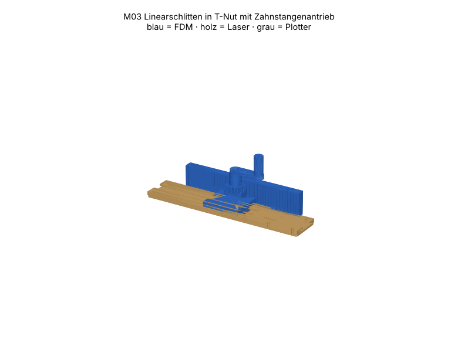

# M03 – Linearschlitten in T-Nut mit Zahnstangenantrieb

> Automatisch erzeugt von `cad/build_all.py` – nicht von Hand bearbeiten. Quelle: `cad/models/m03_linearschlitten.py`

**Zweck:** Lineare Führung + Antrieb, z. B. Verschiebung eines Sensors/Ballasts am Prüfstand. Hub ≈ 138 mm, 94.2 mm pro Kurbelumdrehung.

3D-Ansicht: `cad/assemblies/m03_baugruppe.glb` (z. B. im Browser-glTF-Viewer). Farben: blau = FDM, holz = Laser, grau = Plotter.

**Status:** Konstruktion rechnerisch geprüft (Stufe B, 38/38 Prüfungen bestanden). **Fertigungsfreigabe offen** bis Kalibriercoupons M00 auf dem eigenen Gerät bestanden sind (siehe `manufacturing/process_limits.md`).

## Teile und Verfahrenswahl

| Teil | Bezeichnung | Verfahren | Material | Stk | Orientierung / Hinweis | Begründung |
|---|---|---|---|---|---|---|
| M03-P01 | Grundleiste | Laser 10 W | Laser-Sperrholz Pappel/Linde 3 mm (E1, laserfähiger Leim) (FREI) | 1 | flach | 260 mm lange, exakt gerade Bezugsfläche – Druck würde verziehen. |
| M03-P02 | Distanzleiste | Laser 10 W | Laser-Sperrholz Pappel/Linde 3 mm (E1, laserfähiger Leim) (FREI) | 2 | flach | Nutbreite = Laserkontur; Kerf kompensiert, Nut ±0.05 mm. |
| M03-P03 | Deckleiste | Laser 10 W | Laser-Sperrholz Pappel/Linde 3 mm (E1, laserfähiger Leim) (FREI) | 2 | flach | Hinterschnitt der T-Nut entsteht durch Lagenversatz – ohne Fräsen. |
| M03-P04 | Schlitten | FDM-Druck | PETG (Markenfilament mit Datenblatt) (FREI) | 1 | seitlich liegend: T-Profil auf Bett, Fahrrichtung = Druck-Z | Querschnitt in der Druckebene → überhangfrei, Gleitflächen sind Wände (glatt). |
| M03-P05 | Lagerblock | FDM-Druck | PETG (Markenfilament mit Datenblatt) (FREI) | 1 | flach, Bohrung senkrecht | Gleitlager Ø8 senkrecht gedruckt = rund; getrennt vom Schlitten, damit beide optimal orientiert. |
| M03-P06 | Ritzel z20 | FDM-Druck | PETG (Markenfilament mit Datenblatt) (FREI) | 1 | Zahnfläche auf Bett | Evolvente in Druckebene; Nabe mit Madenschraube. |
| M03-P07 | Zahnstange 42 Z | FDM-Druck | PETG (Markenfilament mit Datenblatt) (FREI) | 1 | stehend, Zahnprofil in Druckebene | Zahnprofil in XY = exakte Teilung; 198 mm passt in Bauraum. |
| M03-P08 | Kurbel | FDM-Druck | PETG (Markenfilament mit Datenblatt) (FREI) | 1 | Arm auf Bett | Handantrieb für Funktionsprüfung |
| M03-P09 | Griffhülse | FDM-Druck | PETG (Markenfilament mit Datenblatt) (FREI) | 1 | stehend | drehbare Griffhülse |

## Normteile

| Teil | Stk | ca. CHF/Stk |
|---|---|---|
| Welle Ø8 h9, 45 mm | 1 | 1.00 |
| Zylinderschraube M3×25 + Mutter (Schiene, durch 3 Lagen + Rasterplatte) | 14 | 0.10 |
| Zylinderschraube M3×16 + Mutter (Lagerblock) | 2 | 0.08 |
| M3×12 (Zahnstange) | 3 | 0.06 |
| Madenschraube M3×8 + Mutter | 2 | 0.08 |
| M4×40 + Stoppmutter (Griff) | 1 | 0.30 |
| Kerzenwachs/Trockenschmierstoff für Nut | 1 | 0.10 |

## Kosten (Richtwert, ANN)

FDM ≈ 127 g → CHF 2.54 · Sperrholz CHF 0.55 · Normteile CHF 3.30 · Plotter/Kleinmaterial CHF 0.50 · **Summe ≈ CHF 6.89**

## Montage

1. Grund-, Distanz- und Deckleisten mit 2 M3-Schrauben je Ende ausrichten, Distanz- und Deckleisten verleimen; Nut mit 26.0-mm-Lehre (Schlittenfuss) beim Trocknen offen halten.
2. Nutflanken mit Wachs einreiben.
3. Zwei M3-Muttern in die Schlitten-Unterseite drücken, Lagerblock mit M3×16 aufschrauben.
4. Schlitten von einem Ende in die Nut schieben – muss mit < 2 N gleiten.
5. Schiene mit 14× M3 auf Systemplatte (Raster y = ±20) schrauben, Zahnstange auf Rasterlinie y = +40.
6. Welle in Lagerblock, Ritzel und Kurbel aufsetzen, Ritzel in Zahnstange eingreifen lassen, Madenschrauben anziehen.

## Funktionsprüfung (Stufe E – noch nicht durchgeführt)

1 Kurbelumdrehung = 94.2 mm Sollweg; Messung über 1 Umdrehung mit Stahllineal, Abweichung < 1 mm. Schlitten kippt quer nicht > 0.5 mm (Messuhr/Fühlerlehre).

## Rechnerische Prüfungen

| Prüfung | Ergebnis | Detail |
|---|---|---|
| Ritzel–Zahnstange ohne Überdeckung (20 Stellungen) | ✅ | max. 0.0000 mm², min. Spalt 0.175 mm |
| T-Nut-Spiel seitlich ≥ 0.2 mm | ✅ | Steg 15.6 in 16, Fuss 25.4 in 26 |
| Zahnstange in Bauraum | ✅ | 198 mm |
| M03-P01 Arbeitsfläche | ✅ | 260.1×50.1 mm in 300×250 |
| M03-P01 Mindeststeg 2.0 mm | ✅ |  |
| M03-P01 Gravur innerhalb Teil | ✅ |  |
| M03-P01 Material PLY3 | ✅ | FREI |
| M03-P02 Arbeitsfläche | ✅ | 260.1×12.1 mm in 300×250 |
| M03-P02 Mindeststeg 2.0 mm | ✅ |  |
| M03-P02 Material PLY3 | ✅ | FREI |
| M03-P03 Arbeitsfläche | ✅ | 260.1×17.1 mm in 300×250 |
| M03-P03 Mindeststeg 2.0 mm | ✅ |  |
| M03-P03 Material PLY3 | ✅ | FREI |
| M03-P04 Bauraum | ✅ | 53.0×13.8×60.0 mm |
| M03-P04 liegt auf Bett | ✅ | zmin=0.000 |
| M03-P04 Solid gültig | ✅ |  |
| M03-P04 Material PETG | ✅ | FREI |
| M03-P05 Bauraum | ✅ | 30.0×20.0×10.0 mm |
| M03-P05 liegt auf Bett | ✅ | zmin=0.000 |
| M03-P05 Solid gültig | ✅ |  |
| M03-P05 Material PETG | ✅ | FREI |
| M03-P06 Bauraum | ✅ | 33.0×33.0×16.0 mm |
| M03-P06 liegt auf Bett | ✅ | zmin=-0.000 |
| M03-P06 Solid gültig | ✅ |  |
| M03-P06 Material PETG | ✅ | FREI |
| M03-P07 Bauraum | ✅ | 197.9×15.4×38.0 mm |
| M03-P07 liegt auf Bett | ✅ | zmin=0.000 |
| M03-P07 Solid gültig | ✅ |  |
| M03-P07 Material PETG | ✅ | FREI |
| M03-P08 Bauraum | ✅ | 57.0×18.0×16.0 mm |
| M03-P08 liegt auf Bett | ✅ | zmin=-0.000 |
| M03-P08 Solid gültig | ✅ |  |
| M03-P08 Material PETG | ✅ | FREI |
| M03-P09 Bauraum | ✅ | 14.0×14.0×30.0 mm |
| M03-P09 liegt auf Bett | ✅ | zmin=0.000 |
| M03-P09 Solid gültig | ✅ |  |
| M03-P09 Material PETG | ✅ | FREI |
| Baugruppe kollisionsfrei | ✅ |  |

## Dateien

- `manufacturing/laser_cut/m03/M03-P01_grundleiste.dxf`
- `manufacturing/laser_cut/m03/M03-P01_grundleiste.svg`
- `manufacturing/laser_cut/m03/M03-P02_distanzleiste.dxf`
- `manufacturing/laser_cut/m03/M03-P02_distanzleiste.svg`
- `manufacturing/laser_cut/m03/M03-P03_deckleiste.dxf`
- `manufacturing/laser_cut/m03/M03-P03_deckleiste.svg`
- `manufacturing/3d_print/m03/M03-P04_schlitten.step`
- `manufacturing/3d_print/m03/M03-P04_schlitten.stl`
- `manufacturing/3d_print/m03/M03-P05_lagerblock.step`
- `manufacturing/3d_print/m03/M03-P05_lagerblock.stl`
- `manufacturing/3d_print/m03/M03-P06_ritzel_z20.step`
- `manufacturing/3d_print/m03/M03-P06_ritzel_z20.stl`
- `manufacturing/3d_print/m03/M03-P07_zahnstange_42_z.step`
- `manufacturing/3d_print/m03/M03-P07_zahnstange_42_z.stl`
- `manufacturing/3d_print/m03/M03-P08_kurbel.step`
- `manufacturing/3d_print/m03/M03-P08_kurbel.stl`
- `manufacturing/3d_print/m03/M03-P09_griffhuelse.step`
- `manufacturing/3d_print/m03/M03-P09_griffhuelse.stl`
- `manufacturing/laser_cut/m03/m03_ply3_bogen1.svg`
- `manufacturing/laser_cut/m03/m03_ply3_bogen1.dxf`
- `cad/assemblies/m03_baugruppe.glb`
