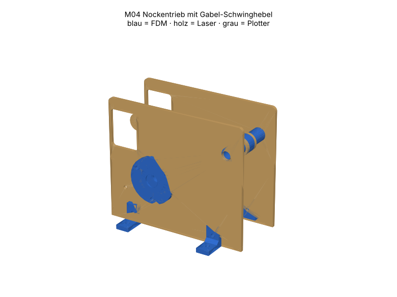

# M04 – Nockentrieb mit Gabel-Schwinghebel

> Automatisch erzeugt von `cad/build_all.py` – nicht von Hand bearbeiten. Quelle: `cad/models/m04_nockentrieb.py`

**Zweck:** Wandelt Drehung in definierte Schwingbewegung (Zykloide, Hub 10 mm, Übersetzung an der Spitze 1.43). Basis für Takt-/Ventilmechaniken; Hebelweg an gravierter Skala ablesbar.

3D-Ansicht: `cad/assemblies/m04_baugruppe.glb` (z. B. im Browser-glTF-Viewer). Farben: blau = FDM, holz = Laser, grau = Plotter.

**Status:** Konstruktion rechnerisch geprüft (Stufe B, 61/61 Prüfungen bestanden). **Fertigungsfreigabe offen** bis Kalibriercoupons M00 auf dem eigenen Gerät bestanden sind (siehe `manufacturing/process_limits.md`).

## Teile und Verfahrenswahl

| Teil | Bezeichnung | Verfahren | Material | Stk | Orientierung / Hinweis | Begründung |
|---|---|---|---|---|---|---|
| M04-P01 | Seitenschild | Laser 10 W | Laser-Sperrholz Pappel/Linde 3 mm (E1, laserfähiger Leim) (FREI) | 2 | flach | Lagerlage, Drehpunkt und Skala in einem Laserjob – Abstände exakt, Skala ohne Zusatzteil. |
| M04-P02 | Lagerflansch 608 | FDM-Druck | PETG (Markenfilament mit Datenblatt) (FREI) | 2 | Flansch auf Bett | Standardelement M01-P04 |
| M04-P03 | Nocken zykloid h10 | FDM-Druck | PETG (Markenfilament mit Datenblatt) (FREI) | 1 | Scheibe auf Bett, Nabe oben | Freiformkontur + Nabe in einem Teil; Kontur in Druckebene = formgenau. |
| M04-P04 | Hebelplatte | Laser 10 W | Laser-Sperrholz Pappel/Linde 3 mm (E1, laserfähiger Leim) (FREI) | 2 | flach | Langer, schlanker Hebel: Sperrholz ist in Längsrichtung steifer als FDM-Schichten und verzugsfrei; Lochabstände exakt. |
| M04-P05 | Gelenkrohr | FDM-Druck | PETG (Markenfilament mit Datenblatt) (FREI) | 1 | stehend | Gleitlager auf Ø8-Bolzen, in Hebelplatten eingeleimt. |
| M04-P06 | Gabelhülse | FDM-Druck | PETG (Markenfilament mit Datenblatt) (FREI) | 1 | stehend | hält Gabelweite exakt; einfacher Druck ohne Überhang (statt Bundbuchse). |
| M04-P07 | Rolle | FDM-Druck | PETG (Markenfilament mit Datenblatt) (FREI) | 1 | stehend | Rollenstössel senkt Reibung gegenüber Gleitstössel. |
| M04-P08 | Spitzenhülse | FDM-Druck | PETG (Markenfilament mit Datenblatt) (FREI) | 1 | stehend | Zeiger + Federhaken |
| M04-P09 | Drehpunkthülse 17.8 | FDM-Druck | PETG (Markenfilament mit Datenblatt) (FREI) | 2 | stehend | zentriert Hebel zwischen den Schilden |
| M04-P10 | Distanzhülse Nabe | FDM-Druck | PETG (Markenfilament mit Datenblatt) (FREI) | 1 | stehend | Axialsicherung |
| M04-P11 | Distanzhülse lang | FDM-Druck | PETG (Markenfilament mit Datenblatt) (FREI) | 1 | stehend | Axialsicherung |
| M04-P12 | Winkelfuss | FDM-Druck | PETG (Markenfilament mit Datenblatt) (FREI) | 4 | liegend | Standardelement M01-P05 |
| M04-P13 | Kurbel | FDM-Druck | PETG (Markenfilament mit Datenblatt) (FREI) | 1 | Arm auf Bett | Handantrieb |
| M04-P14 | Griffhülse | FDM-Druck | PETG (Markenfilament mit Datenblatt) (FREI) | 1 | stehend | Griff |

## Normteile

| Teil | Stk | ca. CHF/Stk |
|---|---|---|
| Rillenkugellager 608-2RS | 2 | 0.80 |
| Welle Ø8 h9, 90 mm (Nocken) | 1 | 1.80 |
| Bolzen Ø8 h9, 65 mm (Drehpunkt) + 2 Stellringe DIN 705 Ø8 | 1 | 2.50 |
| M4×20 + Stoppmutter (Rollenachse) | 1 | 0.15 |
| M3×16 + Mutter (Spitze, Federhaken) | 2 | 0.08 |
| Zugfeder Ø6×30, ca. 0.2 N/mm, oder Gummiring | 1 | 0.40 |
| M3×12 + Mutter (Flansche) | 6 | 0.10 |
| M3×10 + Mutter (Winkelfüsse) | 8 | 0.10 |
| Madenschraube M3×8 + Mutter | 2 | 0.08 |
| M4×40 + Stoppmutter (Griff) | 1 | 0.30 |
| Weissleim | 1 | 0.10 |

## Kosten (Richtwert, ANN)

FDM ≈ 47 g → CHF 0.95 · Sperrholz CHF 0.63 · Normteile CHF 8.57 · Plotter/Kleinmaterial CHF 0.50 · **Summe ≈ CHF 10.65**

## Montage

1. Gelenkrohr durch beide Hebelplatten, Gabelhülse dazwischen; Hebelplatten bündig aufleimen, Rolle mit M4 einsetzen (Achse nicht klemmen).
2. Lager in Flansche pressen, Flansche in Seitenschilde schrauben, Winkelfüsse montieren.
3. Nockenwelle wie bei M02 mit Distanzhülsen einsetzen; Nocken so drehen, dass die Rolle auf dem Grundkreis steht.
4. Drehpunktbolzen durch Schild, Drehpunkthülse, Gelenkrohr, Hülse, Schild; Stellringe aussen.
5. Feder von Spitzenschraube zu Federhakenschraube (M3 im Schild unter Spitze); Rolle muss bei jeder Stellung anliegen.

## Funktionsprüfung (Stufe E – noch nicht durchgeführt)

Kurbel langsam drehen: Zeiger läuft 0 → +7.1 mm → 0 (Skala), stossfrei, Rolle hebt nie ab (Papierstreifen zwischen Rolle/Nocken bleibt eingeklemmt). 50 Umdrehungen ohne Klemmen.

## Rechnerische Prüfungen

| Prüfung | Ergebnis | Detail |
|---|---|---|
| Nocken ohne Unterschnitt (Krümmung Bahnkurve > Rollenradius) | ✅ | Flächenabweichung 0.000 % |
| Max. Druckwinkel ≤ 30° | ✅ | 9.6° |
| Rolle berührt Nocken in Baugruppe (Spalt ≤ 0.05 mm) | ✅ | Spalt 0.009 mm bei Hub h/2 |
| Spitzenweg ±7 mm innerhalb Sichtfenster ±14 mm | ✅ | ±7.1 mm |
| M04-P01 Arbeitsfläche | ✅ | 130.2×110.2 mm in 300×250 |
| M04-P01 Mindeststeg 2.0 mm | ✅ |  |
| M04-P01 Gravur innerhalb Teil | ✅ |  |
| M04-P01 Material PLY3 | ✅ | FREI |
| M04-P02 Bauraum | ✅ | 42.0×42.0×8.0 mm |
| M04-P02 liegt auf Bett | ✅ | zmin=0.000 |
| M04-P02 Solid gültig | ✅ |  |
| M04-P02 Material PETG | ✅ | FREI |
| M04-P03 Bauraum | ✅ | 60.0×61.0×18.0 mm |
| M04-P03 liegt auf Bett | ✅ | zmin=-0.000 |
| M04-P03 Solid gültig | ✅ |  |
| M04-P03 Material PETG | ✅ | FREI |
| M04-P04 Arbeitsfläche | ✅ | 116.2×16.2 mm in 300×250 |
| M04-P04 Mindeststeg 2.0 mm | ✅ |  |
| M04-P04 Gravur innerhalb Teil | ✅ |  |
| M04-P04 Material PLY3 | ✅ | FREI |
| M04-P05 Bauraum | ✅ | 12.0×12.0×14.4 mm |
| M04-P05 liegt auf Bett | ✅ | zmin=0.000 |
| M04-P05 Solid gültig | ✅ |  |
| M04-P05 Material PETG | ✅ | FREI |
| M04-P06 Bauraum | ✅ | 16.0×16.0×8.4 mm |
| M04-P06 liegt auf Bett | ✅ | zmin=0.000 |
| M04-P06 Solid gültig | ✅ |  |
| M04-P06 Material PETG | ✅ | FREI |
| M04-P07 Bauraum | ✅ | 16.0×16.0×8.0 mm |
| M04-P07 liegt auf Bett | ✅ | zmin=0.000 |
| M04-P07 Solid gültig | ✅ |  |
| M04-P07 Material PETG | ✅ | FREI |
| M04-P08 Bauraum | ✅ | 8.0×8.0×8.4 mm |
| M04-P08 liegt auf Bett | ✅ | zmin=0.000 |
| M04-P08 Solid gültig | ✅ |  |
| M04-P08 Material PETG | ✅ | FREI |
| M04-P09 Bauraum | ✅ | 12.0×12.0×17.8 mm |
| M04-P09 liegt auf Bett | ✅ | zmin=0.000 |
| M04-P09 Solid gültig | ✅ |  |
| M04-P09 Material PETG | ✅ | FREI |
| M04-P10 Bauraum | ✅ | 11.0×11.0×10.0 mm |
| M04-P10 liegt auf Bett | ✅ | zmin=0.000 |
| M04-P10 Solid gültig | ✅ |  |
| M04-P10 Material PETG | ✅ | FREI |
| M04-P11 Bauraum | ✅ | 11.0×11.0×20.0 mm |
| M04-P11 liegt auf Bett | ✅ | zmin=0.000 |
| M04-P11 Solid gültig | ✅ |  |
| M04-P11 Material PETG | ✅ | FREI |
| M04-P12 Bauraum | ✅ | 20.0×18.0×12.0 mm |
| M04-P12 liegt auf Bett | ✅ | zmin=0.000 |
| M04-P12 Solid gültig | ✅ |  |
| M04-P12 Material PETG | ✅ | FREI |
| M04-P13 Bauraum | ✅ | 57.0×18.0×16.0 mm |
| M04-P13 liegt auf Bett | ✅ | zmin=-0.000 |
| M04-P13 Solid gültig | ✅ |  |
| M04-P13 Material PETG | ✅ | FREI |
| M04-P14 Bauraum | ✅ | 14.0×14.0×30.0 mm |
| M04-P14 liegt auf Bett | ✅ | zmin=0.000 |
| M04-P14 Solid gültig | ✅ |  |
| M04-P14 Material PETG | ✅ | FREI |
| Baugruppe kollisionsfrei | ✅ |  |

## Dateien

- `manufacturing/laser_cut/m04/M04-P01_seitenschild.dxf`
- `manufacturing/laser_cut/m04/M04-P01_seitenschild.svg`
- `manufacturing/3d_print/m04/M04-P02_lagerflansch_608.step`
- `manufacturing/3d_print/m04/M04-P02_lagerflansch_608.stl`
- `manufacturing/3d_print/m04/M04-P03_nocken_zykloid_h10.step`
- `manufacturing/3d_print/m04/M04-P03_nocken_zykloid_h10.stl`
- `manufacturing/laser_cut/m04/M04-P04_hebelplatte.dxf`
- `manufacturing/laser_cut/m04/M04-P04_hebelplatte.svg`
- `manufacturing/3d_print/m04/M04-P05_gelenkrohr.step`
- `manufacturing/3d_print/m04/M04-P05_gelenkrohr.stl`
- `manufacturing/3d_print/m04/M04-P06_gabelhuelse.step`
- `manufacturing/3d_print/m04/M04-P06_gabelhuelse.stl`
- `manufacturing/3d_print/m04/M04-P07_rolle.step`
- `manufacturing/3d_print/m04/M04-P07_rolle.stl`
- `manufacturing/3d_print/m04/M04-P08_spitzenhuelse.step`
- `manufacturing/3d_print/m04/M04-P08_spitzenhuelse.stl`
- `manufacturing/3d_print/m04/M04-P09_drehpunkthuelse_17_8.step`
- `manufacturing/3d_print/m04/M04-P09_drehpunkthuelse_17_8.stl`
- `manufacturing/3d_print/m04/M04-P10_distanzhuelse_nabe.step`
- `manufacturing/3d_print/m04/M04-P10_distanzhuelse_nabe.stl`
- `manufacturing/3d_print/m04/M04-P11_distanzhuelse_lang.step`
- `manufacturing/3d_print/m04/M04-P11_distanzhuelse_lang.stl`
- `manufacturing/3d_print/m04/M04-P12_winkelfuss.step`
- `manufacturing/3d_print/m04/M04-P12_winkelfuss.stl`
- `manufacturing/3d_print/m04/M04-P13_kurbel.step`
- `manufacturing/3d_print/m04/M04-P13_kurbel.stl`
- `manufacturing/3d_print/m04/M04-P14_griffhuelse.step`
- `manufacturing/3d_print/m04/M04-P14_griffhuelse.stl`
- `manufacturing/laser_cut/m04/m04_ply3_bogen1.svg`
- `manufacturing/laser_cut/m04/m04_ply3_bogen1.dxf`
- `cad/assemblies/m04_baugruppe.glb`
