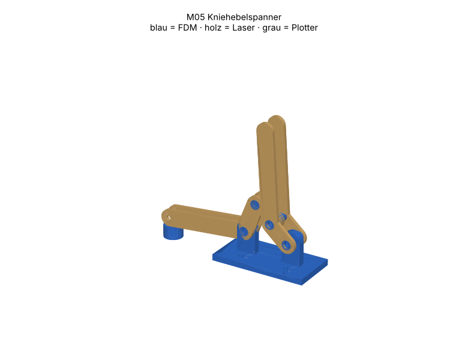

# M05 – Kniehebelspanner

> Automatisch erzeugt von `cad/build_all.py` – nicht von Hand bearbeiten. Quelle: `cad/models/m05_kniehebelspanner.py`

**Zweck:** Werkzeuglose Klemmung (Öffnungshub 59 mm, selbsthemmend über Totpunkt). Einsatz: Schürzenproben, Bauteile, Blendenstrecke am Prüfstand fixieren.

3D-Ansicht: `cad/assemblies/m05_baugruppe.glb` (z. B. im Browser-glTF-Viewer). Farben: blau = FDM, holz = Laser, grau = Plotter.

**Status:** Konstruktion rechnerisch geprüft (Stufe B, 33/33 Prüfungen bestanden). **Fertigungsfreigabe offen** bis Kalibriercoupons M00 auf dem eigenen Gerät bestanden sind (siehe `manufacturing/process_limits.md`).

## Teile und Verfahrenswahl

| Teil | Bezeichnung | Verfahren | Material | Stk | Orientierung / Hinweis | Begründung |
|---|---|---|---|---|---|---|
| M05-P01 | Spannarm | Laser 10 W | Laser-Sperrholz Pappel/Linde 3 mm (E1, laserfähiger Leim) (FREI) | 2 | flach | Flaches Biegeteil mit exakten Gelenkabständen: Laser; zwei Platten aussen = symmetrische Lastaufnahme. |
| M05-P02 | Handhebel | Laser 10 W | Laser-Sperrholz Pappel/Linde 3 mm (E1, laserfähiger Leim) (FREI) | 2 | flach | Hebel lang/schlank, Sperrholz in Faserrichtung steif und bruchzäh. |
| M05-P03 | Koppel | Laser 10 W | Laser-Sperrholz Pappel/Linde 3 mm (E1, laserfähiger Leim) (FREI) | 2 | flach; 2 Lagen verleimt (6 mm) | höchstbelastetes Glied (Druck): Doppellage, Lochabstand bestimmt Totpunktlage → Laser. |
| M05-P04 | Gestellbock | FDM-Druck | PETG (Markenfilament mit Datenblatt) (FREI) | 1 | Fuss auf Bett, Lasche stehend; Gelenkaugen Ø8.2 waagrecht im Druck → mit Reibahle Ø8 H8 nacharbeiten | 3D-Form (Fuss + Lasche) in einem Teil, verschraubt auf Raster. |
| M05-P05 | Gelenkrohr lang (D, C) | FDM-Druck | PETG (Markenfilament mit Datenblatt) (FREI) | 2 | stehend | Gelenk als Verschleissteil: PETG-Rohr läuft in Holzbohrung, billig ersetzbar; M4 klemmt nur das Rohr. |
| M05-P07 | Gelenkstift (A, B) | FDM-Druck | PETG (Markenfilament mit Datenblatt) (FREI) | 2 | stehend, 100 % Infill | kopfloser Stift, in die Armplatten eingeleimt (Bock bzw. Koppel drehen darauf) – der Handhebel überstreicht A und B beim Öffnen ohne Kollision. |
| M05-P06 | Druckstück | FDM-Druck | TPU 95A (FREI) | 1 | flach | weiches, rutschfestes Druckstück schont Schürzengewebe. |

## Normteile

| Teil | Stk | ca. CHF/Stk |
|---|---|---|
| M4×25 + 2 Scheiben + Stoppmutter (Gelenke D, C) | 2 | 0.20 |
| Kunststoffscheibe 8.4×16×1 (Distanz C) | 6 | 0.03 |
| M4×20 + Mutter (Druckstück) | 1 | 0.10 |
| M3×12 + Mutter (Bock auf Raster) | 4 | 0.08 |
| Weissleim (Koppel) | 1 | 0.05 |

## Kosten (Richtwert, ANN)

FDM ≈ 20 g → CHF 0.41 · Sperrholz CHF 0.32 · Normteile CHF 1.05 · Plotter/Kleinmaterial CHF 0.50 · **Summe ≈ CHF 2.29**

## Montage

1. Koppellagen verleimen, mit 8-mm-Dorn in beiden Löchern ausrichten.
2. Gelenkstift B durch Armplatten und Koppel, Armplatten bündig auf den Stift leimen (Koppel muss frei drehen – Papierstreifen als Distanz).
3. Gelenkstift A durch Armplatten und Bock, Armplatten aufleimen (Bock dreht frei); langes Rohr (D) durch Handhebelplatten aussen + Bock, M4×25.
4. Langes Rohr (C) durch Handhebelplatten + Koppel (Distanzscheiben 3.5 mm je Seite), M4×25.
5. M4-Schrauben nur so fest anziehen, dass sich die Platten auf den Rohren frei drehen (Rohr klemmt, Platten nicht).
6. Druckstück am Arm verschrauben, Höhe mit Scheiben einstellen: Spannung tritt 3–5° vor Totpunkt ein.

## Funktionsprüfung (Stufe E – noch nicht durchgeführt)

Klemmen eines 6-mm-Sperrholzstreifens: Hebel rastet hörbar über Totpunkt, Streifen lässt sich mit 20 N Zug nicht herausziehen; 100 Spannzyklen ohne Spielzunahme > 0.3 mm am Druckstück.

## Rechnerische Prüfungen

| Prüfung | Ergebnis | Detail |
|---|---|---|
| Bewegungsraum 0–80° kollisionsfrei (2D, lagenweise) | ✅ |  |
| Viergelenk über 80° Öffnung lösbar | ✅ |  |
| Öffnungshub Druckstück ≥ 20 mm | ✅ | 59.0 mm bei 80° Hebelweg |
| Übertotpunkt: Öffnen erzwingt Nachdrücken 0 < Δ ≤ 0.5 mm (selbsthemmend) | ✅ | Δ = 0.067 mm bei 2.0° Übertotpunkt |
| Kraftübersetzung 3° vor Totpunkt ≥ 10 | ✅ | ≈ 15 : 1 (Griff → Druckstück) |
| Koppellänge plausibel | ✅ | L_BC = 19.05 mm, L_AB = 26.93 mm |
| M05-P01 Arbeitsfläche | ✅ | 94.2×45.1 mm in 300×250 |
| M05-P01 Mindeststeg 2.0 mm | ✅ |  |
| M05-P01 Gravur innerhalb Teil | ✅ |  |
| M05-P01 Material PLY3 | ✅ | FREI |
| M05-P02 Arbeitsfläche | ✅ | 34.0×102.5 mm in 300×250 |
| M05-P02 Mindeststeg 2.0 mm | ✅ |  |
| M05-P02 Material PLY3 | ✅ | FREI |
| M05-P03 Arbeitsfläche | ✅ | 27.2×23.8 mm in 300×250 |
| M05-P03 Mindeststeg 2.0 mm | ✅ |  |
| M05-P03 Material PLY3 | ✅ | FREI |
| M05-P04 Bauraum | ✅ | 80.0×40.0×32.0 mm |
| M05-P04 liegt auf Bett | ✅ | zmin=0.000 |
| M05-P04 Solid gültig | ✅ |  |
| M05-P04 Material PETG | ✅ | FREI |
| M05-P05 Bauraum | ✅ | 8.0×8.0×19.4 mm |
| M05-P05 liegt auf Bett | ✅ | zmin=0.000 |
| M05-P05 Solid gültig | ✅ |  |
| M05-P05 Material PETG | ✅ | FREI |
| M05-P07 Bauraum | ✅ | 8.0×8.0×12.6 mm |
| M05-P07 liegt auf Bett | ✅ | zmin=0.000 |
| M05-P07 Solid gültig | ✅ |  |
| M05-P07 Material PETG | ✅ | FREI |
| M05-P06 Bauraum | ✅ | 16.0×16.0×10.0 mm |
| M05-P06 liegt auf Bett | ✅ | zmin=0.000 |
| M05-P06 Solid gültig | ✅ |  |
| M05-P06 Material TPU95A | ✅ | FREI |
| Baugruppe kollisionsfrei | ✅ |  |

## Dateien

- `manufacturing/laser_cut/m05/M05-P01_spannarm.dxf`
- `manufacturing/laser_cut/m05/M05-P01_spannarm.svg`
- `manufacturing/laser_cut/m05/M05-P02_handhebel.dxf`
- `manufacturing/laser_cut/m05/M05-P02_handhebel.svg`
- `manufacturing/laser_cut/m05/M05-P03_koppel.dxf`
- `manufacturing/laser_cut/m05/M05-P03_koppel.svg`
- `manufacturing/3d_print/m05/M05-P04_gestellbock.step`
- `manufacturing/3d_print/m05/M05-P04_gestellbock.stl`
- `manufacturing/3d_print/m05/M05-P05_gelenkrohr_lang_d_c.step`
- `manufacturing/3d_print/m05/M05-P05_gelenkrohr_lang_d_c.stl`
- `manufacturing/3d_print/m05/M05-P07_gelenkstift_a_b.step`
- `manufacturing/3d_print/m05/M05-P07_gelenkstift_a_b.stl`
- `manufacturing/3d_print/m05/M05-P06_druckstueck.step`
- `manufacturing/3d_print/m05/M05-P06_druckstueck.stl`
- `manufacturing/laser_cut/m05/m05_ply3_bogen1.svg`
- `manufacturing/laser_cut/m05/m05_ply3_bogen1.dxf`
- `cad/assemblies/m05_baugruppe.glb`
