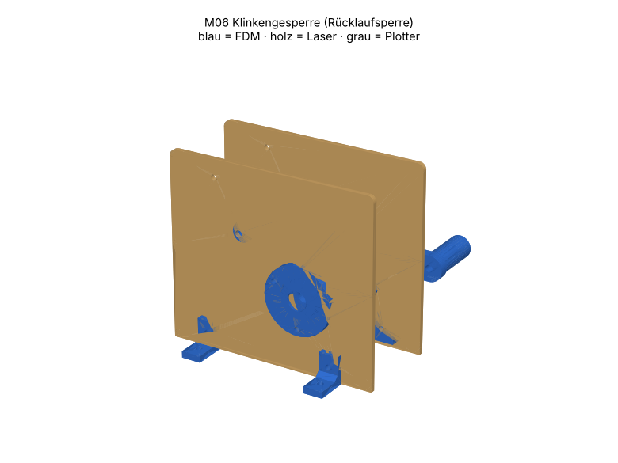

# M06 – Klinkengesperre (Rücklaufsperre)

> Automatisch erzeugt von `cad/build_all.py` – nicht von Hand bearbeiten. Quelle: `cad/models/m06_klinkengesperre.py`

**Zweck:** Lässt Drehung im Uhrzeigersinn (Blick von −y) frei und sperrt die Gegenrichtung in 30°-Schritten. Einsatz: Halten von Seilwinden/Höhenverstellungen, Lehrmodell Gesperre.

3D-Ansicht: `cad/assemblies/m06_baugruppe.glb` (z. B. im Browser-glTF-Viewer). Farben: blau = FDM, holz = Laser, grau = Plotter.

**Status:** Konstruktion rechnerisch geprüft (Stufe B, 48/48 Prüfungen bestanden). **Fertigungsfreigabe offen** bis Kalibriercoupons M00 auf dem eigenen Gerät bestanden sind (siehe `manufacturing/process_limits.md`).

## Teile und Verfahrenswahl

| Teil | Bezeichnung | Verfahren | Material | Stk | Orientierung / Hinweis | Begründung |
|---|---|---|---|---|---|---|
| M06-P01 | Seitenschild | Laser 10 W | Laser-Sperrholz Pappel/Linde 3 mm (E1, laserfähiger Leim) (FREI) | 2 | flach | Lage Radachse ↔ Klinkendrehpunkt bestimmt Funktion → Laser legt beide exakt fest. |
| M06-P02 | Lagerflansch 608 | FDM-Druck | PETG (Markenfilament mit Datenblatt) (FREI) | 2 | Flansch auf Bett | Standardelement M01-P04 |
| M06-P03 | Sperrrad z12 | FDM-Druck | PETG (Markenfilament mit Datenblatt) (FREI) | 1 | Scheibe auf Bett, Nabe oben | Sägezahn + Nabe in einem Teil; Zahnflanken als Wände (glatt, masshaltig). |
| M06-P04 | Klinke | Laser 10 W | Laser-Sperrholz Pappel/Linde 3 mm (E1, laserfähiger Leim) (FREI) | 2 | flach; 2 Lagen verleimt | Klinke ist ein Flachteil mit kritischer Spitzenkontur: Laser formgenau; Doppellage 6 mm = Radbreite. |
| M06-P05 | Klinkenachse (Rohr) | FDM-Druck | PETG (Markenfilament mit Datenblatt) (FREI) | 1 | stehend | Gleitlager der Klinke, M4-Schraube klemmt Rohr zwischen den Schilden (versteift Rahmen). |
| M06-P06 | Klinkenhülse | FDM-Druck | PETG (Markenfilament mit Datenblatt) (FREI) | 2 | stehend | zentriert Klinke axial |
| M06-P07 | Distanzhülse Nabe | FDM-Druck | PETG (Markenfilament mit Datenblatt) (FREI) | 1 | stehend | Axialsicherung |
| M06-P08 | Distanzhülse lang | FDM-Druck | PETG (Markenfilament mit Datenblatt) (FREI) | 1 | stehend | Axialsicherung |
| M06-P09 | Winkelfuss | FDM-Druck | PETG (Markenfilament mit Datenblatt) (FREI) | 4 | liegend | Standardelement M01-P05 |
| M06-P10 | Kurbel | FDM-Druck | PETG (Markenfilament mit Datenblatt) (FREI) | 1 | Arm auf Bett | Antrieb |
| M06-P11 | Griffhülse | FDM-Druck | PETG (Markenfilament mit Datenblatt) (FREI) | 1 | stehend | Griff |

## Normteile

| Teil | Stk | ca. CHF/Stk |
|---|---|---|
| Rillenkugellager 608-2RS | 2 | 0.80 |
| Welle Ø8 h9, 90 mm | 1 | 1.80 |
| M4×60 + Scheiben + Stoppmutter (Klinkenachse) | 1 | 0.25 |
| M3×16 + Mutter (Federhaken, Schwanz) | 2 | 0.08 |
| Zugfeder Ø5×25 oder Gummiring | 1 | 0.40 |
| M3×12 + Mutter (Flansche) | 6 | 0.10 |
| M3×10 + Mutter (Winkelfüsse) | 8 | 0.10 |
| Madenschraube M3×8 + Mutter | 2 | 0.08 |
| M4×40 + Stoppmutter (Griff) | 1 | 0.30 |
| Weissleim | 1 | 0.05 |

## Kosten (Richtwert, ANN)

FDM ≈ 39 g → CHF 0.78 · Sperrholz CHF 0.62 · Normteile CHF 6.12 · Plotter/Kleinmaterial CHF 0.50 · **Summe ≈ CHF 8.02**

## Montage

1. Klinkenlagen verleimen (8-mm-Dorn im Drehloch zum Ausrichten).
2. Rahmen wie M02 aufbauen, Sperrrad mit Hülsen auf Welle; Nabe Richtung +y.
3. Klinkenachse: Rohr mit Hülsen und Klinke zwischen die Schilde, M4×60 durch.
4. Feder von Klinkenschwanz (M3) nach oben zum Federhaken spannen – Klinke liegt mit leichtem Druck auf.

## Funktionsprüfung (Stufe E – noch nicht durchgeführt)

Kurbel in Freilaufrichtung: gleichmässiges Klicken, 12 Rasten/Umdrehung. Gegenrichtung: Rad sperrt nach ≤ 30° und hält 2 N·m (50 N an 40-mm-Kurbel) ohne Abrutschen. Lösen durch Druck auf Klinkenschwanz.

## Rechnerische Prüfungen

| Prüfung | Ergebnis | Detail |
|---|---|---|
| Klinke greift ≥ 2 mm in Zahnlücke | ✅ | Eingriffstiefe 4.86 mm (Zahnhöhe 6 mm) |
| Klinke berührungsfrei in Ruhelage (Spiel) | ✅ | Spalt 0.40 mm |
| Selbsteinrastend: Zahnkraft dreht Klinke ins Rad | ✅ | Mz = -2.0·F (negativ = ins Rad) |
| Klinkenspitze min. Steg ≥ 2 mm | ✅ |  |
| M06-P01 Arbeitsfläche | ✅ | 130.2×115.2 mm in 300×250 |
| M06-P01 Mindeststeg 2.0 mm | ✅ |  |
| M06-P01 Gravur innerhalb Teil | ✅ |  |
| M06-P01 Material PLY3 | ✅ | FREI |
| M06-P02 Bauraum | ✅ | 42.0×42.0×8.0 mm |
| M06-P02 liegt auf Bett | ✅ | zmin=0.000 |
| M06-P02 Solid gültig | ✅ |  |
| M06-P02 Material PETG | ✅ | FREI |
| M06-P03 Bauraum | ✅ | 60.0×60.0×16.0 mm |
| M06-P03 liegt auf Bett | ✅ | zmin=-0.000 |
| M06-P03 Solid gültig | ✅ |  |
| M06-P03 Material PETG | ✅ | FREI |
| M06-P04 Arbeitsfläche | ✅ | 61.7×16.1 mm in 300×250 |
| M06-P04 Mindeststeg 2.0 mm | ✅ |  |
| M06-P04 Material PLY3 | ✅ | FREI |
| M06-P05 Bauraum | ✅ | 8.0×8.0×50.0 mm |
| M06-P05 liegt auf Bett | ✅ | zmin=0.000 |
| M06-P05 Solid gültig | ✅ |  |
| M06-P05 Material PETG | ✅ | FREI |
| M06-P06 Bauraum | ✅ | 12.0×12.0×21.7 mm |
| M06-P06 liegt auf Bett | ✅ | zmin=0.000 |
| M06-P06 Solid gültig | ✅ |  |
| M06-P06 Material PETG | ✅ | FREI |
| M06-P07 Bauraum | ✅ | 11.0×11.0×11.0 mm |
| M06-P07 liegt auf Bett | ✅ | zmin=0.000 |
| M06-P07 Solid gültig | ✅ |  |
| M06-P07 Material PETG | ✅ | FREI |
| M06-P08 Bauraum | ✅ | 11.0×11.0×21.0 mm |
| M06-P08 liegt auf Bett | ✅ | zmin=0.000 |
| M06-P08 Solid gültig | ✅ |  |
| M06-P08 Material PETG | ✅ | FREI |
| M06-P09 Bauraum | ✅ | 20.0×18.0×12.0 mm |
| M06-P09 liegt auf Bett | ✅ | zmin=0.000 |
| M06-P09 Solid gültig | ✅ |  |
| M06-P09 Material PETG | ✅ | FREI |
| M06-P10 Bauraum | ✅ | 57.0×18.0×16.0 mm |
| M06-P10 liegt auf Bett | ✅ | zmin=-0.000 |
| M06-P10 Solid gültig | ✅ |  |
| M06-P10 Material PETG | ✅ | FREI |
| M06-P11 Bauraum | ✅ | 14.0×14.0×30.0 mm |
| M06-P11 liegt auf Bett | ✅ | zmin=0.000 |
| M06-P11 Solid gültig | ✅ |  |
| M06-P11 Material PETG | ✅ | FREI |
| Baugruppe kollisionsfrei | ✅ |  |

## Dateien

- `manufacturing/laser_cut/m06/M06-P01_seitenschild.dxf`
- `manufacturing/laser_cut/m06/M06-P01_seitenschild.svg`
- `manufacturing/3d_print/m06/M06-P02_lagerflansch_608.step`
- `manufacturing/3d_print/m06/M06-P02_lagerflansch_608.stl`
- `manufacturing/3d_print/m06/M06-P03_sperrrad_z12.step`
- `manufacturing/3d_print/m06/M06-P03_sperrrad_z12.stl`
- `manufacturing/laser_cut/m06/M06-P04_klinke.dxf`
- `manufacturing/laser_cut/m06/M06-P04_klinke.svg`
- `manufacturing/3d_print/m06/M06-P05_klinkenachse_rohr.step`
- `manufacturing/3d_print/m06/M06-P05_klinkenachse_rohr.stl`
- `manufacturing/3d_print/m06/M06-P06_klinkenhuelse.step`
- `manufacturing/3d_print/m06/M06-P06_klinkenhuelse.stl`
- `manufacturing/3d_print/m06/M06-P07_distanzhuelse_nabe.step`
- `manufacturing/3d_print/m06/M06-P07_distanzhuelse_nabe.stl`
- `manufacturing/3d_print/m06/M06-P08_distanzhuelse_lang.step`
- `manufacturing/3d_print/m06/M06-P08_distanzhuelse_lang.stl`
- `manufacturing/3d_print/m06/M06-P09_winkelfuss.step`
- `manufacturing/3d_print/m06/M06-P09_winkelfuss.stl`
- `manufacturing/3d_print/m06/M06-P10_kurbel.step`
- `manufacturing/3d_print/m06/M06-P10_kurbel.stl`
- `manufacturing/3d_print/m06/M06-P11_griffhuelse.step`
- `manufacturing/3d_print/m06/M06-P11_griffhuelse.stl`
- `manufacturing/laser_cut/m06/m06_ply3_bogen1.svg`
- `manufacturing/laser_cut/m06/m06_ply3_bogen1.dxf`
- `cad/assemblies/m06_baugruppe.glb`
