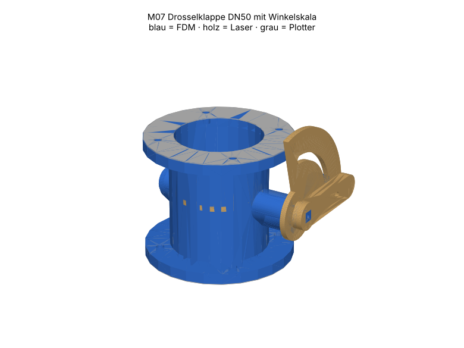

# M07 – Drosselklappe DN50 mit Winkelskala

> Automatisch erzeugt von `cad/build_all.py` – nicht von Hand bearbeiten. Quelle: `cad/models/m07_drosselklappe.py`

**Zweck:** Stufenlos einstellbarer Strömungswiderstand 0–90° (klemmbar). Mit M08 ergibt sich die Gebläsekennlinie p(Q) am Prüfstand A0 ohne Blendenwechsel. Keine Absperrarmatur (Ringspalt 0.5 mm).

3D-Ansicht: `cad/assemblies/m07_baugruppe.glb` (z. B. im Browser-glTF-Viewer). Farben: blau = FDM, holz = Laser, grau = Plotter.

**Status:** Konstruktion rechnerisch geprüft (Stufe B, 30/30 Prüfungen bestanden). **Fertigungsfreigabe offen** bis Kalibriercoupons M00 auf dem eigenen Gerät bestanden sind (siehe `manufacturing/process_limits.md`).

## Teile und Verfahrenswahl

| Teil | Bezeichnung | Verfahren | Material | Stk | Orientierung / Hinweis | Begründung |
|---|---|---|---|---|---|---|
| M07-P01 | Gehäuse DN50 | FDM-Druck | PETG (Markenfilament mit Datenblatt) (FREI) | 1 | stehend (Rohrachse = Z), Flansch auf Bett; Bosse als Tropfenprofil stützenfrei | Rohr, Flansche, Lagerbosse und Skalenzapfen bilden eine 3D-Form: nur Druck sinnvoll. |
| M07-P02 | Klappenwelle | FDM-Druck | PETG (Markenfilament mit Datenblatt) (FREI) | 1 | stehend, Kopf auf Bett, 100 % Infill | Kopf, Lagerzapfen, Abflachung und Vierkant in einem Teil; stehend = runde Lagerflächen. |
| M07-P03 | Klappenscheibe | Laser 10 W | Laser-Sperrholz Pappel/Linde 3 mm (E1, laserfähiger Leim) (FREI) | 1 | flach | Kreisrunde, ebene Scheibe mit 0.5 mm Ringspalt: Laser exakter und verzugsfreier als Druck. |
| M07-P04 | Skalenplatte | Laser 10 W | Laser-Sperrholz Pappel/Linde 3 mm (E1, laserfähiger Leim) (FREI) | 1 | flach, Gravur vorn | Skala gravieren + D-Loch + Bogenschlitz in einem Job; kein Zusatzteil, keine Druckzeit. |
| M07-P05 | Stellhebel | Laser 10 W | Laser-Sperrholz Pappel/Linde 3 mm (E1, laserfähiger Leim) (FREI) | 2 | flach, 2 Lagen verleimt | Vierkantloch 6.1 mm passgenau (Kerf kompensiert); Doppellage = 6 mm Vierkantlänge. |
| M07-P06 | Klemmknopf M4 | FDM-Druck | PETG (Markenfilament mit Datenblatt) (FREI) | 1 | flach, Mutterfalle oben | Rändelknopf mit eingelegter M4-Mutter, werkzeuglos. |
| M07-P07 | Flanschdichtung | Schneidplotter | Faserdichtungspapier 0.5 mm, Zellulose/NBR-frei, chlorfrei deklariert (TEST) | 2 | – | 0.5 mm Flachdichtung: Messerplotter schneidet ohne Brandkante; Laser für Dichtpapier nicht nötig. |

## Normteile

| Teil | Stk | ca. CHF/Stk |
|---|---|---|
| M3×12 + Mutter (Scheibe) | 2 | 0.06 |
| M3×8 Blechschraube + Scheibe Ø9 (Hebelsicherung) | 1 | 0.05 |
| M4×16 + Scheibe (Klemmung) | 1 | 0.06 |
| Mutter M4 (im Knopf) | 1 | 0.03 |
| M4×20 + Mutter (Flansch, je Verbindung) | 4 | 0.10 |
| Weissleim | 1 | 0.05 |

## Kosten (Richtwert, ANN)

FDM ≈ 68 g → CHF 1.37 · Sperrholz CHF 0.16 · Normteile CHF 0.71 · Plotter/Kleinmaterial CHF 0.50 · **Summe ≈ CHF 2.74**

## Montage

1. Welle von −x durch Gehäuse schieben, Abflachung nach oben (Klappe zu = Scheibe waagrecht).
2. Scheibe von oben ins Rohr legen, auf Abflachung mit 2× M3×12 verschrauben (Muttern unten).
3. Skalenplatte auf D-Zapfen stecken (0° = Scheibe zu).
4. Hebellagen verleimen, auf Vierkant stecken, mit Blechschraube + Scheibe axial sichern.
5. M4×16 von vorn durch Hebel und Bogenschlitz, Klemmknopf hinten aufdrehen.
6. Flanschdichtungen beidseitig, 4× M4 je Flansch über Kreuz anziehen.

## Funktionsprüfung (Stufe E – noch nicht durchgeführt)

Hebel 0–90° leichtgängig (< 0.1 N·m), Klemmung hält bei 1 kPa Vordruck. Leckstrom bei 0° mit Gebläse messen und dokumentieren (Ringspalt bewusst, kein Absperrorgan).

## Rechnerische Prüfungen

| Prüfung | Ergebnis | Detail |
|---|---|---|
| Scheibe dreht frei im Rohr (Hüllradius < R) | ✅ | Hüllradius 24.68 mm, R = 25.0 mm |
| Skalen-/Hebelebene ausserhalb Flansch (x > 42) | ✅ | x = 48.0 mm |
| Vierkant passt durch Lagerbohrung (Montage) | ✅ | Diagonale 8.49 mm |
| M07-P01 Bauraum | ✅ | 93.0×84.0×70.0 mm |
| M07-P01 liegt auf Bett | ✅ | zmin=0.000 |
| M07-P01 Solid gültig | ✅ |  |
| M07-P01 Material PETG | ✅ | FREI |
| M07-P02 Bauraum | ✅ | 14.0×14.0×93.0 mm |
| M07-P02 liegt auf Bett | ✅ | zmin=0.000 |
| M07-P02 Solid gültig | ✅ |  |
| M07-P02 Material PETG | ✅ | FREI |
| M07-P03 Arbeitsfläche | ✅ | 49.2×49.1 mm in 300×250 |
| M07-P03 Mindeststeg 2.0 mm | ✅ |  |
| M07-P03 Gravur innerhalb Teil | ✅ |  |
| M07-P03 Material PLY3 | ✅ | FREI |
| M07-P04 Arbeitsfläche | ✅ | 63.1×63.1 mm in 300×250 |
| M07-P04 Mindeststeg 2.0 mm | ✅ |  |
| M07-P04 Gravur innerhalb Teil | ✅ |  |
| M07-P04 Material PLY3 | ✅ | FREI |
| M07-P05 Arbeitsfläche | ✅ | 61.1×16.1 mm in 300×250 |
| M07-P05 Mindeststeg 2.0 mm | ✅ |  |
| M07-P05 Material PLY3 | ✅ | FREI |
| M07-P06 Bauraum | ✅ | 19.9×19.9×8.0 mm |
| M07-P06 liegt auf Bett | ✅ | zmin=0.000 |
| M07-P06 Solid gültig | ✅ |  |
| M07-P06 Material PETG | ✅ | FREI |
| M07-P07 Arbeitsfläche | ✅ | 83.5×83.5 mm in 288×290 |
| M07-P07 Mindeststeg 3.0 mm | ✅ |  |
| M07-P07 Material GASKET05 | ✅ | TEST |
| Baugruppe kollisionsfrei | ✅ |  |

## Dateien

- `manufacturing/3d_print/m07/M07-P01_gehaeuse_dn50.step`
- `manufacturing/3d_print/m07/M07-P01_gehaeuse_dn50.stl`
- `manufacturing/3d_print/m07/M07-P02_klappenwelle.step`
- `manufacturing/3d_print/m07/M07-P02_klappenwelle.stl`
- `manufacturing/laser_cut/m07/M07-P03_klappenscheibe.dxf`
- `manufacturing/laser_cut/m07/M07-P03_klappenscheibe.svg`
- `manufacturing/laser_cut/m07/M07-P04_skalenplatte.dxf`
- `manufacturing/laser_cut/m07/M07-P04_skalenplatte.svg`
- `manufacturing/laser_cut/m07/M07-P05_stellhebel.dxf`
- `manufacturing/laser_cut/m07/M07-P05_stellhebel.svg`
- `manufacturing/3d_print/m07/M07-P06_klemmknopf_m4.step`
- `manufacturing/3d_print/m07/M07-P06_klemmknopf_m4.stl`
- `manufacturing/plotter/m07/M07-P07_flanschdichtung.dxf`
- `manufacturing/plotter/m07/M07-P07_flanschdichtung.svg`
- `manufacturing/laser_cut/m07/m07_ply3_bogen1.svg`
- `manufacturing/laser_cut/m07/m07_ply3_bogen1.dxf`
- `manufacturing/plotter/m07/m07_gasket05_bogen1.svg`
- `manufacturing/plotter/m07/m07_gasket05_bogen1.dxf`
- `cad/assemblies/m07_baugruppe.glb`
