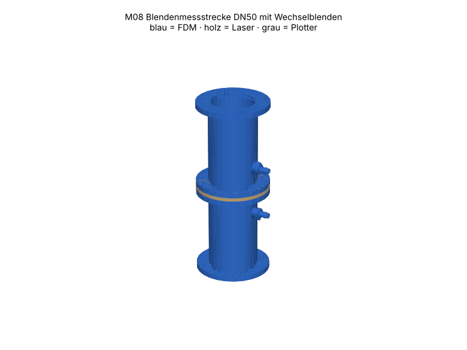

# M08 – Blendenmessstrecke DN50 mit Wechselblenden

> Automatisch erzeugt von `cad/build_all.py` – nicht von Hand bearbeiten. Quelle: `cad/models/m08_blendenmessstrecke.py`

**Zweck:** Volumenstrommessung für die Gebläsekennlinie am Prüfstand A0: Δp über Blende mit U-Rohr (M12). Q = C·A·√(2Δp/ρ)/√(1−β⁴), C ≈ 0.61 nur als Startwert – Kalibrierung zwingend.

3D-Ansicht: `cad/assemblies/m08_baugruppe.glb` (z. B. im Browser-glTF-Viewer). Farben: blau = FDM, holz = Laser, grau = Plotter.

**Status:** Konstruktion rechnerisch geprüft (Stufe B, 62/62 Prüfungen bestanden). **Fertigungsfreigabe offen** bis Kalibriercoupons M00 auf dem eigenen Gerät bestanden sind (siehe `manufacturing/process_limits.md`).

## Teile und Verfahrenswahl

| Teil | Bezeichnung | Verfahren | Material | Stk | Orientierung / Hinweis | Begründung |
|---|---|---|---|---|---|---|
| M08-P01 | Ein-/Auslaufstück | FDM-Druck | PETG (Markenfilament mit Datenblatt) (FREI) | 2 | stehend, Flansch auf Bett; Messbohrung als Tropfen (stützenfrei) | Rohr mit Flanschen und Messboss = 3D-Form → Druck; identisches Teil zweimal, gedreht eingebaut. |
| M08-P02 | Messstutzen | FDM-Druck | PETG (Markenfilament mit Datenblatt) (FREI) | 2 | stehend | Widerhaken rotationssymmetrisch → stehend gedruckt formgenau. |
| M08-P05 | Flanschdichtung | Schneidplotter | Faserdichtungspapier 0.5 mm, Zellulose/NBR-frei, chlorfrei deklariert (TEST) | 2 | – | dünne Dichtung = Plotter; keine thermische Randschädigung. |
| M08-P03a | Blende d15 | Laser 10 W | Laser-Sperrholz Pappel/Linde 3 mm (E1, laserfähiger Leim) (FREI) | 1 | flach, Gravur zuströmseitig | Bohrung Ø auf ±0.05 mm (Kerf kompensiert), Satz in einem Job; Lasche mit Gravur verhindert Verwechslung. |
| M08-P03b | Blende d20 | Laser 10 W | Laser-Sperrholz Pappel/Linde 3 mm (E1, laserfähiger Leim) (FREI) | 1 | flach, Gravur zuströmseitig | Bohrung Ø auf ±0.05 mm (Kerf kompensiert), Satz in einem Job; Lasche mit Gravur verhindert Verwechslung. |
| M08-P03c | Blende d25 | Laser 10 W | Laser-Sperrholz Pappel/Linde 3 mm (E1, laserfähiger Leim) (FREI) | 1 | flach, Gravur zuströmseitig | Bohrung Ø auf ±0.05 mm (Kerf kompensiert), Satz in einem Job; Lasche mit Gravur verhindert Verwechslung. |
| M08-P03d | Blende d30 | Laser 10 W | Laser-Sperrholz Pappel/Linde 3 mm (E1, laserfähiger Leim) (FREI) | 1 | flach, Gravur zuströmseitig | Bohrung Ø auf ±0.05 mm (Kerf kompensiert), Satz in einem Job; Lasche mit Gravur verhindert Verwechslung. |
| M08-P03e | Blende d35 | Laser 10 W | Laser-Sperrholz Pappel/Linde 3 mm (E1, laserfähiger Leim) (FREI) | 1 | flach, Gravur zuströmseitig | Bohrung Ø auf ±0.05 mm (Kerf kompensiert), Satz in einem Job; Lasche mit Gravur verhindert Verwechslung. |
| M08-P03f | Blende d40 | Laser 10 W | Laser-Sperrholz Pappel/Linde 3 mm (E1, laserfähiger Leim) (FREI) | 1 | flach, Gravur zuströmseitig | Bohrung Ø auf ±0.05 mm (Kerf kompensiert), Satz in einem Job; Lasche mit Gravur verhindert Verwechslung. |
| M08-P04a | PET-Blende d15 scharfkantig | Schneidplotter | PET-Folie 0.19 mm (PET-A/PET-G, klar, als PET deklariert) (TEST) | 1 | – | 0.19 mm Kante ≈ scharfkantig; Plotter schneidet PET ohne Schmelze (Laser 455 nm schneidet klares PET nicht). |
| M08-P04b | PET-Blende d20 scharfkantig | Schneidplotter | PET-Folie 0.19 mm (PET-A/PET-G, klar, als PET deklariert) (TEST) | 1 | – | 0.19 mm Kante ≈ scharfkantig; Plotter schneidet PET ohne Schmelze (Laser 455 nm schneidet klares PET nicht). |
| M08-P04c | PET-Blende d25 scharfkantig | Schneidplotter | PET-Folie 0.19 mm (PET-A/PET-G, klar, als PET deklariert) (TEST) | 1 | – | 0.19 mm Kante ≈ scharfkantig; Plotter schneidet PET ohne Schmelze (Laser 455 nm schneidet klares PET nicht). |
| M08-P04d | PET-Blende d30 scharfkantig | Schneidplotter | PET-Folie 0.19 mm (PET-A/PET-G, klar, als PET deklariert) (TEST) | 1 | – | 0.19 mm Kante ≈ scharfkantig; Plotter schneidet PET ohne Schmelze (Laser 455 nm schneidet klares PET nicht). |
| M08-P04e | PET-Blende d35 scharfkantig | Schneidplotter | PET-Folie 0.19 mm (PET-A/PET-G, klar, als PET deklariert) (TEST) | 1 | – | 0.19 mm Kante ≈ scharfkantig; Plotter schneidet PET ohne Schmelze (Laser 455 nm schneidet klares PET nicht). |
| M08-P04f | PET-Blende d40 scharfkantig | Schneidplotter | PET-Folie 0.19 mm (PET-A/PET-G, klar, als PET deklariert) (TEST) | 1 | – | 0.19 mm Kante ≈ scharfkantig; Plotter schneidet PET ohne Schmelze (Laser 455 nm schneidet klares PET nicht). |
| M08-P06 | Stützring für PET-Blenden | Laser 10 W | Laser-Sperrholz Pappel/Linde 3 mm (E1, laserfähiger Leim) (FREI) | 1 | abströmseitig hinter PET-Blende | Stützt PET-Folie gegen Δp-Durchbiegung; Ø = dmax + 6 mm wirkt als Abströmfase. Für kleinere d zusätzliche Ringe mit d+6 nach Bedarf (Parameter). |

## Normteile

| Teil | Stk | ca. CHF/Stk |
|---|---|---|
| M4×25 + Mutter + 2 Scheiben (Blendenflansch) | 4 | 0.12 |
| PU-/Silikonschlauch ID 6 mm, 2 m | 1 | 3.00 |
| Sekundenkleber/Epoxid (Messstutzen) | 1 | 0.20 |

## Kosten (Richtwert, ANN)

FDM ≈ 144 g → CHF 2.88 · Sperrholz CHF 1.09 · Normteile CHF 3.68 · Plotter/Kleinmaterial CHF 0.50 · **Summe ≈ CHF 8.15**

## Montage

1. Messstutzen in die Sitze der beiden Rohrstücke einkleben; Bohrung Ø3.2 innen gratfrei entgraten (Grat verfälscht Δp).
2. Einlauf (Messboss zur Blende) – Dichtung – Blende (Gravur zuströmseitig) – Dichtung – Auslauf (Messboss zur Blende).
3. 4× M4 über Kreuz handfest; Blendenlasche zeigt nach oben (Verwechslungsschutz).
4. PET-Variante: PET-Blende zuströmseitig, Stützring abströmseitig, beide zwischen die Dichtungen.

## Funktionsprüfung (Stufe E – noch nicht durchgeführt)

Dichtheit: Auslass zu, 1 kPa Überdruck, Druckabfall < 10 % in 60 s. Kalibrierung: je Blende 5 Volumenströme gegen Anemometer (Rohr 10·D hinter Auslauf), C(Re) als Tabelle in testing/ ablegen.

## Rechnerische Prüfungen

| Prüfung | Ergebnis | Detail |
|---|---|---|
| β-Bereich 0.3–0.8 | ✅ | β = 0.30 … 0.80 |
| Messbohrung 25.4 mm vor/nach Blende (Flanschanbohrung) | ✅ | 25.4 mm, Bohrung Ø3.2 |
| Scharfkantige PET-Variante: Dicke ≤ 0.05·D | ✅ | PET 0.19 mm ≤ 2.5 mm; Holzblende 3.0 mm ist NICHT normkonform → nur kalibriert verwenden |
| Messbereiche (50–2000 Pa) benachbarter Blenden überlappen lückenlos | ✅ | d15: 1.0–6.3 l/s, d20: 1.8–11.3 l/s, d25: 2.8–17.9 l/s, d30: 4.2–26.8 l/s, d35: 6.2–39.0 l/s, d40: 9.1–57.8 l/s |
| M08-P01 Bauraum | ✅ | 84.0×84.0×100.0 mm |
| M08-P01 liegt auf Bett | ✅ | zmin=0.000 |
| M08-P01 Solid gültig | ✅ |  |
| M08-P01 Material PETG | ✅ | FREI |
| M08-P02 Bauraum | ✅ | 9.0×9.0×19.5 mm |
| M08-P02 liegt auf Bett | ✅ | zmin=0.000 |
| M08-P02 Solid gültig | ✅ |  |
| M08-P02 Material PETG | ✅ | FREI |
| M08-P05 Arbeitsfläche | ✅ | 83.5×83.5 mm in 288×290 |
| M08-P05 Mindeststeg 3.0 mm | ✅ |  |
| M08-P05 Material GASKET05 | ✅ | TEST |
| M08-P03a Arbeitsfläche | ✅ | 84.2×95.2 mm in 300×250 |
| M08-P03a Mindeststeg 2.0 mm | ✅ |  |
| M08-P03a Gravur innerhalb Teil | ✅ |  |
| M08-P03a Material PLY3 | ✅ | FREI |
| M08-P03b Arbeitsfläche | ✅ | 84.2×95.2 mm in 300×250 |
| M08-P03b Mindeststeg 2.0 mm | ✅ |  |
| M08-P03b Gravur innerhalb Teil | ✅ |  |
| M08-P03b Material PLY3 | ✅ | FREI |
| M08-P03c Arbeitsfläche | ✅ | 84.2×95.2 mm in 300×250 |
| M08-P03c Mindeststeg 2.0 mm | ✅ |  |
| M08-P03c Gravur innerhalb Teil | ✅ |  |
| M08-P03c Material PLY3 | ✅ | FREI |
| M08-P03d Arbeitsfläche | ✅ | 84.2×95.2 mm in 300×250 |
| M08-P03d Mindeststeg 2.0 mm | ✅ |  |
| M08-P03d Gravur innerhalb Teil | ✅ |  |
| M08-P03d Material PLY3 | ✅ | FREI |
| M08-P03e Arbeitsfläche | ✅ | 84.2×95.2 mm in 300×250 |
| M08-P03e Mindeststeg 2.0 mm | ✅ |  |
| M08-P03e Gravur innerhalb Teil | ✅ |  |
| M08-P03e Material PLY3 | ✅ | FREI |
| M08-P03f Arbeitsfläche | ✅ | 84.2×95.2 mm in 300×250 |
| M08-P03f Mindeststeg 2.0 mm | ✅ |  |
| M08-P03f Gravur innerhalb Teil | ✅ |  |
| M08-P03f Material PLY3 | ✅ | FREI |
| M08-P04a Arbeitsfläche | ✅ | 84.0×95.0 mm in 288×290 |
| M08-P04a Mindeststeg 3.0 mm | ✅ |  |
| M08-P04a Material PET019 | ✅ | TEST |
| M08-P04b Arbeitsfläche | ✅ | 84.0×95.0 mm in 288×290 |
| M08-P04b Mindeststeg 3.0 mm | ✅ |  |
| M08-P04b Material PET019 | ✅ | TEST |
| M08-P04c Arbeitsfläche | ✅ | 84.0×95.0 mm in 288×290 |
| M08-P04c Mindeststeg 3.0 mm | ✅ |  |
| M08-P04c Material PET019 | ✅ | TEST |
| M08-P04d Arbeitsfläche | ✅ | 84.0×95.0 mm in 288×290 |
| M08-P04d Mindeststeg 3.0 mm | ✅ |  |
| M08-P04d Material PET019 | ✅ | TEST |
| M08-P04e Arbeitsfläche | ✅ | 84.0×95.0 mm in 288×290 |
| M08-P04e Mindeststeg 3.0 mm | ✅ |  |
| M08-P04e Material PET019 | ✅ | TEST |
| M08-P04f Arbeitsfläche | ✅ | 84.0×95.0 mm in 288×290 |
| M08-P04f Mindeststeg 3.0 mm | ✅ |  |
| M08-P04f Material PET019 | ✅ | TEST |
| M08-P06 Arbeitsfläche | ✅ | 84.2×95.2 mm in 300×250 |
| M08-P06 Mindeststeg 2.0 mm | ✅ |  |
| M08-P06 Gravur innerhalb Teil | ✅ |  |
| M08-P06 Material PLY3 | ✅ | FREI |
| Baugruppe kollisionsfrei | ✅ |  |

## Dateien

- `manufacturing/3d_print/m08/M08-P01_ein_auslaufstueck.step`
- `manufacturing/3d_print/m08/M08-P01_ein_auslaufstueck.stl`
- `manufacturing/3d_print/m08/M08-P02_messstutzen.step`
- `manufacturing/3d_print/m08/M08-P02_messstutzen.stl`
- `manufacturing/plotter/m08/M08-P05_flanschdichtung.dxf`
- `manufacturing/plotter/m08/M08-P05_flanschdichtung.svg`
- `manufacturing/laser_cut/m08/M08-P03a_blende_d15.dxf`
- `manufacturing/laser_cut/m08/M08-P03a_blende_d15.svg`
- `manufacturing/laser_cut/m08/M08-P03b_blende_d20.dxf`
- `manufacturing/laser_cut/m08/M08-P03b_blende_d20.svg`
- `manufacturing/laser_cut/m08/M08-P03c_blende_d25.dxf`
- `manufacturing/laser_cut/m08/M08-P03c_blende_d25.svg`
- `manufacturing/laser_cut/m08/M08-P03d_blende_d30.dxf`
- `manufacturing/laser_cut/m08/M08-P03d_blende_d30.svg`
- `manufacturing/laser_cut/m08/M08-P03e_blende_d35.dxf`
- `manufacturing/laser_cut/m08/M08-P03e_blende_d35.svg`
- `manufacturing/laser_cut/m08/M08-P03f_blende_d40.dxf`
- `manufacturing/laser_cut/m08/M08-P03f_blende_d40.svg`
- `manufacturing/plotter/m08/M08-P04a_pet_blende_d15_scharfkantig.dxf`
- `manufacturing/plotter/m08/M08-P04a_pet_blende_d15_scharfkantig.svg`
- `manufacturing/plotter/m08/M08-P04b_pet_blende_d20_scharfkantig.dxf`
- `manufacturing/plotter/m08/M08-P04b_pet_blende_d20_scharfkantig.svg`
- `manufacturing/plotter/m08/M08-P04c_pet_blende_d25_scharfkantig.dxf`
- `manufacturing/plotter/m08/M08-P04c_pet_blende_d25_scharfkantig.svg`
- `manufacturing/plotter/m08/M08-P04d_pet_blende_d30_scharfkantig.dxf`
- `manufacturing/plotter/m08/M08-P04d_pet_blende_d30_scharfkantig.svg`
- `manufacturing/plotter/m08/M08-P04e_pet_blende_d35_scharfkantig.dxf`
- `manufacturing/plotter/m08/M08-P04e_pet_blende_d35_scharfkantig.svg`
- `manufacturing/plotter/m08/M08-P04f_pet_blende_d40_scharfkantig.dxf`
- `manufacturing/plotter/m08/M08-P04f_pet_blende_d40_scharfkantig.svg`
- `manufacturing/laser_cut/m08/M08-P06_stuetzring_fuer_pet_blenden.dxf`
- `manufacturing/laser_cut/m08/M08-P06_stuetzring_fuer_pet_blenden.svg`
- `manufacturing/laser_cut/m08/m08_ply3_bogen1.svg`
- `manufacturing/laser_cut/m08/m08_ply3_bogen1.dxf`
- `manufacturing/laser_cut/m08/m08_ply3_bogen2.svg`
- `manufacturing/laser_cut/m08/m08_ply3_bogen2.dxf`
- `manufacturing/plotter/m08/m08_gasket05_bogen1.svg`
- `manufacturing/plotter/m08/m08_gasket05_bogen1.dxf`
- `manufacturing/plotter/m08/m08_pet019_bogen1.svg`
- `manufacturing/plotter/m08/m08_pet019_bogen1.dxf`
- `cad/assemblies/m08_baugruppe.glb`
