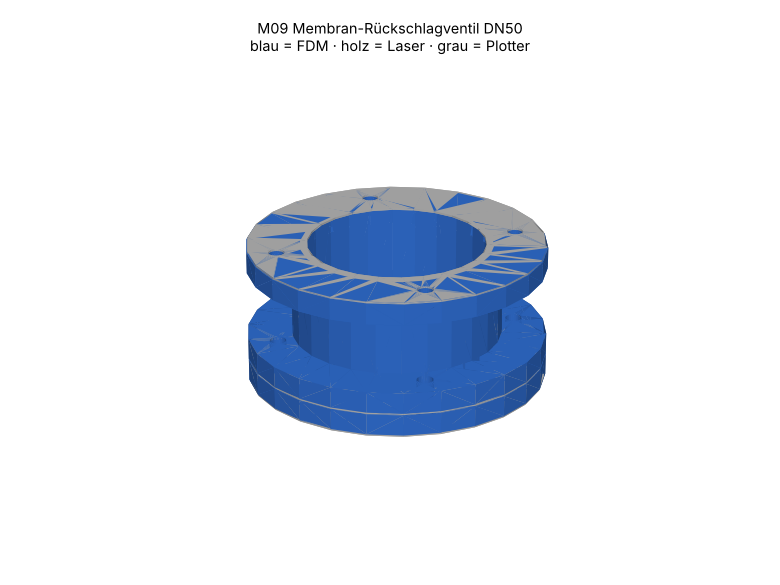

# M09 – Membran-Rückschlagventil DN50

> Automatisch erzeugt von `cad/build_all.py` – nicht von Hand bearbeiten. Quelle: `cad/models/m09_membranventil.py`

**Zweck:** Sperrt Rückströmung bei Gebläsestillstand; Öffnungsdruck abhängig von Membransteifigkeit (PET ≈ 20–60 Pa, Silikon tiefer – messen).

3D-Ansicht: `cad/assemblies/m09_baugruppe.glb` (z. B. im Browser-glTF-Viewer). Farben: blau = FDM, holz = Laser, grau = Plotter.

**Status:** Konstruktion rechnerisch geprüft (Stufe B, 27/27 Prüfungen bestanden). **Fertigungsfreigabe offen** bis Kalibriercoupons M00 auf dem eigenen Gerät bestanden sind (siehe `manufacturing/process_limits.md`).

## Teile und Verfahrenswahl

| Teil | Bezeichnung | Verfahren | Material | Stk | Orientierung / Hinweis | Begründung |
|---|---|---|---|---|---|---|
| M09-P01 | Ventilsitz | FDM-Druck | PETG (Markenfilament mit Datenblatt) (FREI) | 1 | flach; Dichtfläche (Membranseite) auf glattem Bett – im Einbau gewendet | Speichen, Nabe und Flansch in einem Teil; Dichtfläche auf glatter Druckplatte = eben (< 0.05 mm). |
| M09-P02 | Membran PET 0.19 | Schneidplotter | PET-Folie 0.19 mm (PET-A/PET-G, klar, als PET deklariert) (TEST) | 1 | – | Dünne, ebene, gratfreie Folie: Messerplotter; Laser schneidet klares PET nicht. |
| M09-P03 | Klemmteller | FDM-Druck | PETG (Markenfilament mit Datenblatt) (FREI) | 1 | flach | klemmt Membran mittig, Rand frei beweglich |
| M09-P04 | Ventilgehäuse ID54 | FDM-Druck | PETG (Markenfilament mit Datenblatt) (FREI) | 1 | stehend, Flansch auf Bett | Hubraum für Membran (ID 54 > Ø50), Flansch beidseitig → Druck. |
| M09-P05 | Dichtung Gehäuseseite ID56 | Schneidplotter | Faserdichtungspapier 0.5 mm, Zellulose/NBR-frei, chlorfrei deklariert (TEST) | 1 | – | Innen-Ø grösser als Membran → klemmt sie nicht. |
| M09-P06 | Flanschdichtung | Schneidplotter | Faserdichtungspapier 0.5 mm, Zellulose/NBR-frei, chlorfrei deklariert (TEST) | 2 | – | Standarddichtung DN50 |

## Normteile

| Teil | Stk | ca. CHF/Stk |
|---|---|---|
| M3×12 + Mutter + Scheibe (Membranklemmung) | 1 | 0.06 |
| M4×45 + Mutter (Durchsteck, je Ventil) | 4 | 0.14 |

## Kosten (Richtwert, ANN)

FDM ≈ 62 g → CHF 1.23 · Sperrholz CHF 0.00 · Normteile CHF 0.62 · Plotter/Kleinmaterial CHF 0.50 · **Summe ≈ CHF 2.35**

## Montage

1. Sitz mit Dichtfläche nach oben hinlegen, Membran auflegen, Klemmteller + M3 mittig (nur leicht: Membran nicht verziehen).
2. Dichtung ID56 auf den Sitzflansch, Gehäuse aufsetzen; Strömungsrichtung: Sitz → Gehäuse.
3. Mit Nachbarmodulen und Standarddichtungen über 4× M4 verbinden.

## Funktionsprüfung (Stufe E – noch nicht durchgeführt)

Blasen in Sitzseite: Membran öffnet; Saugen/Gegendruck 500 Pa: Leckage < 5 % des Nennstroms (Seifenblasentest am Rand). Öffnungsdruck mit U-Rohr (M12) protokollieren.

## Rechnerische Prüfungen

| Prüfung | Ergebnis | Detail |
|---|---|---|
| Membran überdeckt Ports ≥ 3 mm (Dichtsteg) | ✅ | Steg 3.0 mm |
| Portfläche ≥ 50 % Rohrquerschnitt | ✅ | 51 % |
| Hubraum ≥ erforderlicher Hub für Vollquerschnitt | ✅ | benötigt 12.5 mm, frei 29 mm |
| Membran frei im Gehäuse (radial) | ✅ | Spalt 2.0 mm je Seite |
| Plotter: Membranloch ≥ Mindestmass | ✅ | Ø3.4 für M3 |
| M09-P01 Bauraum | ✅ | 84.0×84.0×6.0 mm |
| M09-P01 liegt auf Bett | ✅ | zmin=0.000 |
| M09-P01 Solid gültig | ✅ |  |
| M09-P01 Material PETG | ✅ | FREI |
| M09-P02 Arbeitsfläche | ✅ | 50.0×50.0 mm in 288×290 |
| M09-P02 Mindeststeg 3.0 mm | ✅ |  |
| M09-P02 Material PET019 | ✅ | TEST |
| M09-P03 Bauraum | ✅ | 18.0×18.0×3.0 mm |
| M09-P03 liegt auf Bett | ✅ | zmin=0.000 |
| M09-P03 Solid gültig | ✅ |  |
| M09-P03 Material PETG | ✅ | FREI |
| M09-P04 Bauraum | ✅ | 84.0×84.0×32.0 mm |
| M09-P04 liegt auf Bett | ✅ | zmin=0.000 |
| M09-P04 Solid gültig | ✅ |  |
| M09-P04 Material PETG | ✅ | FREI |
| M09-P05 Arbeitsfläche | ✅ | 83.5×83.5 mm in 288×290 |
| M09-P05 Mindeststeg 3.0 mm | ✅ |  |
| M09-P05 Material GASKET05 | ✅ | TEST |
| M09-P06 Arbeitsfläche | ✅ | 83.5×83.5 mm in 288×290 |
| M09-P06 Mindeststeg 3.0 mm | ✅ |  |
| M09-P06 Material GASKET05 | ✅ | TEST |
| Baugruppe kollisionsfrei | ✅ |  |

## Dateien

- `manufacturing/3d_print/m09/M09-P01_ventilsitz.step`
- `manufacturing/3d_print/m09/M09-P01_ventilsitz.stl`
- `manufacturing/plotter/m09/M09-P02_membran_pet_0_19.dxf`
- `manufacturing/plotter/m09/M09-P02_membran_pet_0_19.svg`
- `manufacturing/3d_print/m09/M09-P03_klemmteller.step`
- `manufacturing/3d_print/m09/M09-P03_klemmteller.stl`
- `manufacturing/3d_print/m09/M09-P04_ventilgehaeuse_id54.step`
- `manufacturing/3d_print/m09/M09-P04_ventilgehaeuse_id54.stl`
- `manufacturing/plotter/m09/M09-P05_dichtung_gehaeuseseite_id56.dxf`
- `manufacturing/plotter/m09/M09-P05_dichtung_gehaeuseseite_id56.svg`
- `manufacturing/plotter/m09/M09-P06_flanschdichtung.dxf`
- `manufacturing/plotter/m09/M09-P06_flanschdichtung.svg`
- `manufacturing/plotter/m09/m09_pet019_bogen1.svg`
- `manufacturing/plotter/m09/m09_pet019_bogen1.dxf`
- `manufacturing/plotter/m09/m09_gasket05_bogen1.svg`
- `manufacturing/plotter/m09/m09_gasket05_bogen1.dxf`
- `cad/assemblies/m09_baugruppe.glb`
