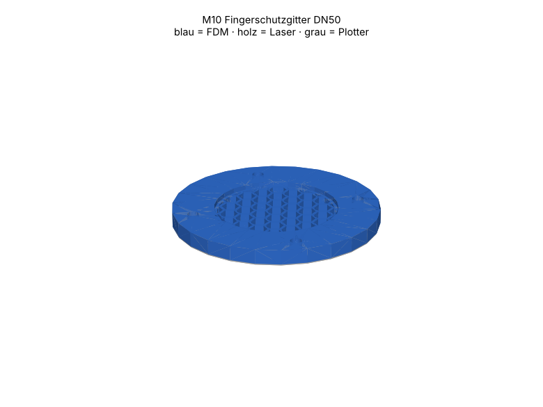

# M10 – Fingerschutzgitter DN50

> Automatisch erzeugt von `cad/build_all.py` – nicht von Hand bearbeiten. Quelle: `cad/models/m10_schutzgitter.py`

**Zweck:** Berührschutz für Ein- und Auslässe (Gefährdung H-03). Ersetzt keine Sicherheitsbewertung.

3D-Ansicht: `cad/assemblies/m10_baugruppe.glb` (z. B. im Browser-glTF-Viewer). Farben: blau = FDM, holz = Laser, grau = Plotter.

**Status:** Konstruktion rechnerisch geprüft (Stufe B, 12/12 Prüfungen bestanden). **Fertigungsfreigabe offen** bis Kalibriercoupons M00 auf dem eigenen Gerät bestanden sind (siehe `manufacturing/process_limits.md`).

## Teile und Verfahrenswahl

| Teil | Bezeichnung | Verfahren | Material | Stk | Orientierung / Hinweis | Begründung |
|---|---|---|---|---|---|---|
| M10-P01 | Schutzgitter e6 | FDM-Druck | PETG (Markenfilament mit Datenblatt) (FREI) | 1 | flach (Gitter in Druckebene, keine Brücken) | 1.2-mm-Stege + Flansch einteilig, flach gedruckt = fest, maßhaltig, nicht brennbar wie dünnes Holz. |
| M10-P02 | Flanschdichtung | Schneidplotter | Faserdichtungspapier 0.5 mm, Zellulose/NBR-frei, chlorfrei deklariert (TEST) | 1 | – | Standarddichtung DN50 |

## Normteile

| Teil | Stk | ca. CHF/Stk |
|---|---|---|
| M4×(Flanschpaket+10) + Mutter | 4 | 0.12 |

## Kosten (Richtwert, ANN)

FDM ≈ 20 g → CHF 0.40 · Sperrholz CHF 0.00 · Normteile CHF 0.48 · Plotter/Kleinmaterial CHF 0.50 · **Summe ≈ CHF 1.38**

## Montage

1. Gitter mit Dichtung zwischen Gebläseadapter und Luftstrecke einsetzen, Gitterseite zum Rotor.
2. Abstand Gitter–Rotorblatt messen und dokumentieren (Soll ≥ 25 mm, ANN).

## Funktionsprüfung (Stufe E – noch nicht durchgeführt)

Prüfstift Ø6 h11 darf keine Öffnung passieren (Schlüsselweite), Prüffinger (IEC 61032 Sonde B, kalibriert, nicht gedruckt) erreicht den Rotor nicht. 50 N Fingerdruck auf Gittermitte: kein Bruch.

## Rechnerische Prüfungen

| Prüfung | Ergebnis | Detail |
|---|---|---|
| Öffnung (Schlüsselweite) ≤ 6 mm | ✅ | e = 6.0 mm, Eckmass 6.9 mm |
| Steg ≥ 3 × 0.4-Düse? (≥ 1.2 mm) | ✅ | 1.2 mm |
| Freie Fläche ≥ 55 % | ✅ | φ = 62 %, ζ ≈ 1.72, Δp(10 m/s) ≈ 102 Pa |
| Sicherheitsabstand zum Rotor als Einbauforderung dokumentiert | ✅ | ≥ 25 mm (ANN) – Prüfung ISO 13857 durch Fachperson offen |
| M10-P01 Bauraum | ✅ | 84.0×84.0×6.0 mm |
| M10-P01 liegt auf Bett | ✅ | zmin=0.000 |
| M10-P01 Solid gültig | ✅ |  |
| M10-P01 Material PETG | ✅ | FREI |
| M10-P02 Arbeitsfläche | ✅ | 83.5×83.5 mm in 288×290 |
| M10-P02 Mindeststeg 3.0 mm | ✅ |  |
| M10-P02 Material GASKET05 | ✅ | TEST |
| Baugruppe kollisionsfrei | ✅ |  |

## Dateien

- `manufacturing/3d_print/m10/M10-P01_schutzgitter_e6.step`
- `manufacturing/3d_print/m10/M10-P01_schutzgitter_e6.stl`
- `manufacturing/plotter/m10/M10-P02_flanschdichtung.dxf`
- `manufacturing/plotter/m10/M10-P02_flanschdichtung.svg`
- `manufacturing/plotter/m10/m10_gasket05_bogen1.svg`
- `manufacturing/plotter/m10/m10_gasket05_bogen1.dxf`
- `cad/assemblies/m10_baugruppe.glb`
