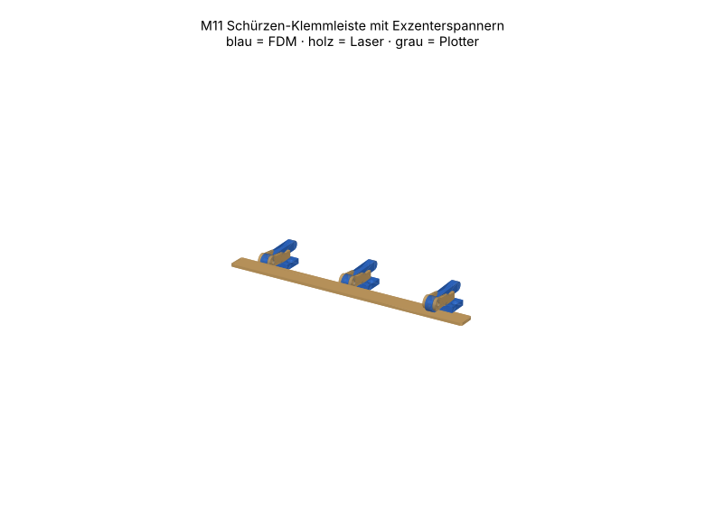

# M11 – Schürzen-Klemmleiste mit Exzenterspannern

> Automatisch erzeugt von `cad/build_all.py` – nicht von Hand bearbeiten. Quelle: `cad/models/m11_schuerzenklemme.py`

**Zweck:** Klemmt Schürzengewebe (0.1–0.5 mm) am Plattformrand des Prüfstands A0 werkzeuglos, wechselbar für Schürzenvarianten. Je 280 mm Leiste 3 Spanner; Plattformumfang ≈ 2.4 m → 9 Leisten (Eckbereiche gesondert).

3D-Ansicht: `cad/assemblies/m11_baugruppe.glb` (z. B. im Browser-glTF-Viewer). Farben: blau = FDM, holz = Laser, grau = Plotter.

**Status:** Konstruktion rechnerisch geprüft (Stufe B, 23/23 Prüfungen bestanden). **Fertigungsfreigabe offen** bis Kalibriercoupons M00 auf dem eigenen Gerät bestanden sind (siehe `manufacturing/process_limits.md`).

## Teile und Verfahrenswahl

| Teil | Bezeichnung | Verfahren | Material | Stk | Orientierung / Hinweis | Begründung |
|---|---|---|---|---|---|---|
| M11-P01 | Klemmleiste | Laser 10 W | Laser-Sperrholz Pappel/Linde 3 mm (E1, laserfähiger Leim) (FREI) | 1 | flach | 280 mm gerade Druckleiste: Laser in Sekunden, verzugsfrei; Druck bräuchte 2 h und verzieht. |
| M11-P02 | Spannbock-Basis | FDM-Druck | PETG (Markenfilament mit Datenblatt) (FREI) | 3 | flach | Flaches Teil mit Wangenschlitzen und Senkungen – überhangfrei. |
| M11-P03 | Wange | Laser 10 W | Laser-Sperrholz Pappel/Linde 3 mm (E1, laserfähiger Leim) (FREI) | 6 | flach | Wangenprofil mit Drehpunkt als 2D-Kontur exakt; ersetzt einen überhängenden Druck. |
| M11-P04 | Exzenterhebel | FDM-Druck | PETG (Markenfilament mit Datenblatt) (FREI) | 3 | flach (Profil in Druckebene), 100 % Infill im Exzenter | Exzenterkontur + Drehloch in Druckebene → rund und genau; 8 mm breit. |
| M11-P05 | Bohrschablone | Schneidplotter | Fotokarton ≤ 0.5 mm (300 g/m²) (FREI) | 1 | Stift: Leistenkanten + Achsmarken; Messer: Kontur + Ø3.5-Körnerlöcher | Flexibel, legt sich an Plattformrand; Plotter zeichnet und schneidet in einem Durchgang. |

## Normteile

| Teil | Stk | ca. CHF/Stk |
|---|---|---|
| M4×20 + Stoppmutter + 2 Scheiben (Drehpunkt) | 3 | 0.20 |
| Spanplattenschraube 3.5×16 Senkkopf | 6 | 0.03 |
| Weissleim (Wangen in Basis) | 1 | 0.05 |

## Kosten (Richtwert, ANN)

FDM ≈ 20 g → CHF 0.41 · Sperrholz CHF 0.20 · Normteile CHF 0.83 · Plotter/Kleinmaterial CHF 0.50 · **Summe ≈ CHF 1.93**

## Montage

1. Bohrschablone an Plattformkante anlegen, Ø3.5-Löcher ankörnen/vorbohren (Ø2.5), Achsmarken übertragen.
2. Wangen in Basisschlitze leimen (Drehlöcher fluchtend mit M4-Schraube ausrichten).
3. Exzenterhebel zwischen die Wangen, M4 mit Stoppmutter (Hebel muss frei drehen).
4. Spannböcke mit 2× 3.5×16 an den Marken verschrauben.
5. Gewebe über die Kante legen, Klemmleiste auflegen, Hebel nach innen umlegen.

## Funktionsprüfung (Stufe E – noch nicht durchgeführt)

Gewebestreifen 50 mm breit unter einem Spanner: Auszugskraft ≥ 30 N (Federwaage A0-10) ohne Rutschen; Hebel öffnet nicht selbsttätig bei 100 Klopfstössen auf die Plattform.

## Rechnerische Prüfungen

| Prüfung | Ergebnis | Detail |
|---|---|---|
| Selbsthemmung Exzenter e < μ·R | ✅ | e = 1.0 mm < 2.4 mm (μ = 0.3, ANN) |
| Exzenter liegt gespannt an Leiste an (Spalt ≤ 0.05 mm, ohne Gewebe) | ✅ | 0.002 mm |
| Öffnungsspalt ≥ 1.5 mm (Gewebe einlegen) | ✅ | 2.00 mm |
| Wangen-Mindeststeg | ✅ |  |
| M11-P01 Arbeitsfläche | ✅ | 280.1×20.1 mm in 300×250 |
| M11-P01 Mindeststeg 2.0 mm | ✅ |  |
| M11-P01 Gravur innerhalb Teil | ✅ |  |
| M11-P01 Material PLY3 | ✅ | FREI |
| M11-P02 Bauraum | ✅ | 32.6×22.0×6.0 mm |
| M11-P02 liegt auf Bett | ✅ | zmin=0.000 |
| M11-P02 Solid gültig | ✅ |  |
| M11-P02 Material PETG | ✅ | FREI |
| M11-P03 Arbeitsfläche | ✅ | 39.1×19.1 mm in 300×250 |
| M11-P03 Mindeststeg 2.0 mm | ✅ |  |
| M11-P03 Material PLY3 | ✅ | FREI |
| M11-P04 Bauraum | ✅ | 58.0×16.0×8.0 mm |
| M11-P04 liegt auf Bett | ✅ | zmin=0.000 |
| M11-P04 Solid gültig | ✅ |  |
| M11-P04 Material PETG | ✅ | FREI |
| M11-P05 Arbeitsfläche | ✅ | 280.0×60.0 mm in 288×290 |
| M11-P05 Mindeststeg 3.0 mm | ✅ |  |
| M11-P05 Material CARD05 | ✅ | FREI |
| Baugruppe kollisionsfrei | ✅ |  |

## Dateien

- `manufacturing/laser_cut/m11/M11-P01_klemmleiste.dxf`
- `manufacturing/laser_cut/m11/M11-P01_klemmleiste.svg`
- `manufacturing/3d_print/m11/M11-P02_spannbock_basis.step`
- `manufacturing/3d_print/m11/M11-P02_spannbock_basis.stl`
- `manufacturing/laser_cut/m11/M11-P03_wange.dxf`
- `manufacturing/laser_cut/m11/M11-P03_wange.svg`
- `manufacturing/3d_print/m11/M11-P04_exzenterhebel.step`
- `manufacturing/3d_print/m11/M11-P04_exzenterhebel.stl`
- `manufacturing/plotter/m11/M11-P05_bohrschablone.dxf`
- `manufacturing/plotter/m11/M11-P05_bohrschablone.svg`
- `manufacturing/laser_cut/m11/m11_ply3_bogen1.svg`
- `manufacturing/laser_cut/m11/m11_ply3_bogen1.dxf`
- `manufacturing/plotter/m11/m11_card05_bogen1.svg`
- `manufacturing/plotter/m11/m11_card05_bogen1.dxf`
- `cad/assemblies/m11_baugruppe.glb`
