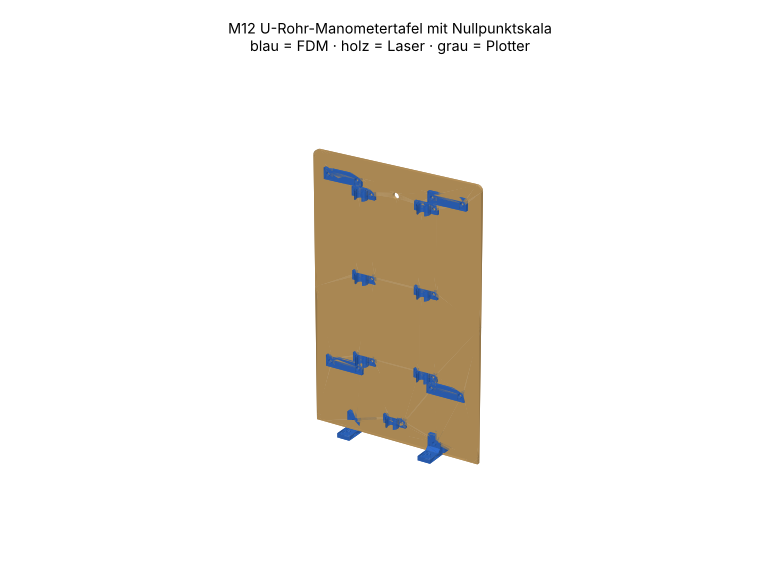

# M12 – U-Rohr-Manometertafel mit Nullpunktskala

> Automatisch erzeugt von `cad/build_all.py` – nicht von Hand bearbeiten. Quelle: `cad/models/m12_manometertafel.py`

**Zweck:** Differenzdruckmessung (Kissendruck, Blenden-Δp M08, Öffnungsdruck M09) ohne Elektronik. Wasser mit Lebensmittelfarbe; Ablesung beider Schenkel, Δp = ρ·g·(h₁+h₂).

3D-Ansicht: `cad/assemblies/m12_baugruppe.glb` (z. B. im Browser-glTF-Viewer). Farben: blau = FDM, holz = Laser, grau = Plotter.

**Status:** Konstruktion rechnerisch geprüft (Stufe B, 24/24 Prüfungen bestanden). **Fertigungsfreigabe offen** bis Kalibriercoupons M00 auf dem eigenen Gerät bestanden sind (siehe `manufacturing/process_limits.md`).

## Teile und Verfahrenswahl

| Teil | Bezeichnung | Verfahren | Material | Stk | Orientierung / Hinweis | Begründung |
|---|---|---|---|---|---|---|
| M12-P01 | Tafel | Laser 10 W | Laser-Sperrholz Pappel/Linde 3 mm (E1, laserfähiger Leim) (FREI) | 1 | flach, Gravur vorn | Grosse ebene Tafel mit 36 Bohrungen + Formel graviert: Laser; fällt in 300×250-Feld. |
| M12-P02 | Schlauchclip OD8 | FDM-Druck | PETG (Markenfilament mit Datenblatt) (FREI) | 7 | flach (C-Profil in Druckebene) | Schnappring braucht Elastizität von PETG. |
| M12-P03 | Skalenführung | FDM-Druck | PETG (Markenfilament mit Datenblatt) (FREI) | 4 | flach | Kanal 0.8 mm hält Karton reibschlüssig, verschiebbar. |
| M12-P04 | Skalenstreifen ±90 mm | Schneidplotter | Fotokarton ≤ 0.5 mm (300 g/m²) (FREI) | 2 | Stift: Teilung + Ziffern, dann Messer: Kontur | Plotter zeichnet 1-mm-Teilung (Stift) und schneidet aus; austauschbar, Nullpunkt verschiebbar. |
| M12-P05 | Winkelfuss | FDM-Druck | PETG (Markenfilament mit Datenblatt) (FREI) | 4 | liegend | Standardelement M01-P05 |

## Normteile

| Teil | Stk | ca. CHF/Stk |
|---|---|---|
| PU-Schlauch 8×6 mm transparent, 0.8 m (kein PVC nötig) | 1 | 2.50 |
| M3×10 + Mutter (Clips, Führungen) | 22 | 0.08 |
| M3×10 + Mutter (Winkelfüsse) | 8 | 0.08 |
| Lebensmittelfarbe, Wasser | 1 | 0.20 |

## Kosten (Richtwert, ANN)

FDM ≈ 11 g → CHF 0.23 · Sperrholz CHF 0.77 · Normteile CHF 5.10 · Plotter/Kleinmaterial CHF 0.50 · **Summe ≈ CHF 6.60**

## Montage

1. Clips und Skalenführungen auf die Tafel schrauben (Muttern hinten).
2. Schlauch als U einclipsen (Bogen unten), Enden über Messstutzen (M08/M09) bzw. offen.
3. Wasser einfüllen bis ≈ Mitte, Blasen entfernen; Tafel mit Wasserwaage lotrecht stellen.
4. Skalenstreifen in die Führungen schieben und auf Meniskus-Unterkante auf 0 stellen.

## Funktionsprüfung (Stufe E – noch nicht durchgeführt)

Beide Schenkel offen: Pegel gleich (±0.5 mm). Einseitig Spritze 100 mm WS: h₁+h₂ = 100 ± 2 mm; nach 10 min kein Pegelabfall (dicht).

## Rechnerische Prüfungen

| Prüfung | Ergebnis | Detail |
|---|---|---|
| Biegeradius U-Bogen ≥ 30 mm (PU 8/6, ANN) | ✅ | R = 30.0 mm |
| Messbereich ≥ ±1.5 kPa (Kissendruck Phase 0 ≈ 1.1 kPa) | ✅ | ±1762 Pa (Summe beider Schenkel) |
| Skalenstreifen in Plotterfläche | ✅ | 200 mm |
| Schenkel-Abstand ≥ 2·Biegeradius | ✅ | 60 mm |
| M12-P01 Arbeitsfläche | ✅ | 160.2×248.1 mm in 300×250 |
| M12-P01 Mindeststeg 2.0 mm | ✅ |  |
| M12-P01 Gravur innerhalb Teil | ✅ |  |
| M12-P01 Material PLY3 | ✅ | FREI |
| M12-P02 Bauraum | ✅ | 22.0×10.1×8.0 mm |
| M12-P02 liegt auf Bett | ✅ | zmin=0.000 |
| M12-P02 Solid gültig | ✅ |  |
| M12-P02 Material PETG | ✅ | FREI |
| M12-P03 Bauraum | ✅ | 36.0×3.0×10.0 mm |
| M12-P03 liegt auf Bett | ✅ | zmin=0.000 |
| M12-P03 Solid gültig | ✅ |  |
| M12-P03 Material PETG | ✅ | FREI |
| M12-P04 Arbeitsfläche | ✅ | 20.0×200.0 mm in 288×290 |
| M12-P04 Mindeststeg 3.0 mm | ✅ |  |
| M12-P04 Material CARD05 | ✅ | FREI |
| M12-P05 Bauraum | ✅ | 20.0×18.0×12.0 mm |
| M12-P05 liegt auf Bett | ✅ | zmin=0.000 |
| M12-P05 Solid gültig | ✅ |  |
| M12-P05 Material PETG | ✅ | FREI |
| Baugruppe kollisionsfrei | ✅ |  |

## Dateien

- `manufacturing/laser_cut/m12/M12-P01_tafel.dxf`
- `manufacturing/laser_cut/m12/M12-P01_tafel.svg`
- `manufacturing/3d_print/m12/M12-P02_schlauchclip_od8.step`
- `manufacturing/3d_print/m12/M12-P02_schlauchclip_od8.stl`
- `manufacturing/3d_print/m12/M12-P03_skalenfuehrung.step`
- `manufacturing/3d_print/m12/M12-P03_skalenfuehrung.stl`
- `manufacturing/plotter/m12/M12-P04_skalenstreifen_90_mm.dxf`
- `manufacturing/plotter/m12/M12-P04_skalenstreifen_90_mm.svg`
- `manufacturing/3d_print/m12/M12-P05_winkelfuss.step`
- `manufacturing/3d_print/m12/M12-P05_winkelfuss.stl`
- `manufacturing/laser_cut/m12/m12_ply3_bogen1.svg`
- `manufacturing/laser_cut/m12/m12_ply3_bogen1.dxf`
- `manufacturing/plotter/m12/m12_card05_bogen1.svg`
- `manufacturing/plotter/m12/m12_card05_bogen1.dxf`
- `cad/assemblies/m12_baugruppe.glb`
